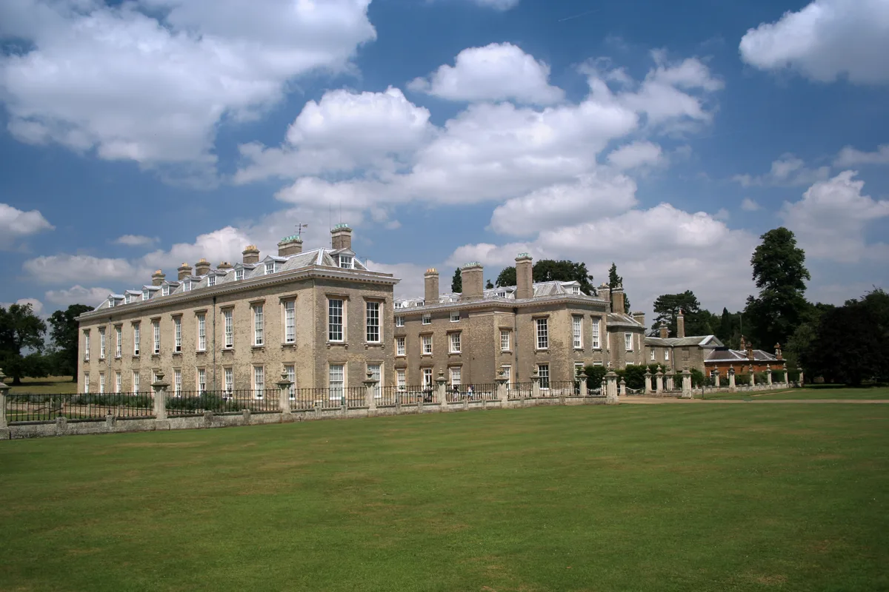
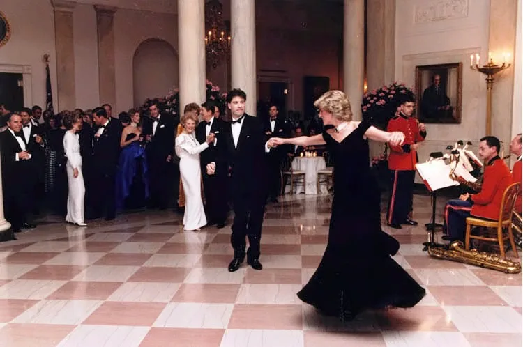
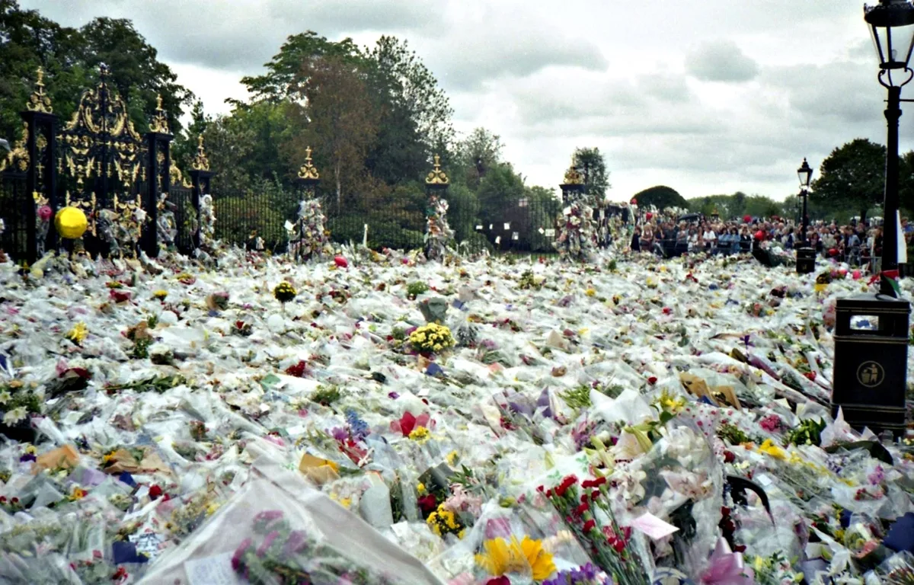

Andrew Morton's "Diana: Her True Story," published in 1992, remains a controversial yet influential biography of Diana, Princess of Wales.  It offered a candid and, at the time, unprecedented glimpse into the private life of a member of the British Royal Family, shattering the carefully constructed image of regal perfection and revealing a woman grappling with immense pressure, emotional turmoil, and a profound sense of isolation. While the book’s accuracy has been debated, its impact on public perception of the monarchy and Diana herself was undeniable.  This summary will explore Diana's life as portrayed by Morton, focusing on her personal journey, key relationships, and lasting legacy.

## Early Life and Family Dynamics

Morton paints a picture of a childhood marked by both privilege and instability. Diana Frances Spencer was born into aristocratic lineage, but her family life was far from idyllic. Her parents' tumultuous marriage, marked by infidelity and eventual divorce, left a lasting emotional scar.  The book details a childhood that, despite outward appearances, was characterized by a lack of parental affection and a feeling of being overlooked and undervalued. This early sense of insecurity, according to Morton, deeply influenced Diana's future relationships and her vulnerability to manipulation.  Her education was unremarkable, and the book highlights the lack of intellectual stimulation she experienced, contrasting with the expectations and pressures of her future royal role.

<figure class="photo-figure">
  
  <figcaption>Althorp House, the Spencer family estate, photographed in 2006. Photo: <a href="https://commons.wikimedia.org/wiki/File:Althorp_House.jpg">Andrew Walker (walker44), Wikimedia Commons</a>, <a href="https://creativecommons.org/licenses/by-sa/2.5/">CC BY-SA 2.5</a>. Resized and converted to WebP.</figcaption>
</figure>

## Marriage to Prince Charles and the Rise to Public Affection

Diana's marriage to Prince Charles, the heir to the British throne, was portrayed by Morton as a fairytale façade masking a deeply unhappy reality.  The book suggests the marriage was far from a love match, highlighting Charles's continued relationship with Camilla Parker Bowles.  Diana's struggle to navigate the complexities of royal life, coupled with her perceived inadequacy in the eyes of the royal establishment and her husband's coldness, are central themes.  The book meticulously details the pressures of royal protocol, the isolation within the royal family, and the emotional toll it took on Diana.  However, it also depicts Diana's gradual emergence as a powerful and charismatic figure, earning the affection of the public through her charitable work, her approachable demeanor, and her genuine empathy for the less fortunate.  Morton highlights her groundbreaking work with AIDS patients, challenging the stigma surrounding the disease, and her commitment to various charities focusing on the vulnerable and marginalized.  These acts of compassion resonated deeply with the British public, solidifying her image as the "People's Princess."

## Bulimia, Emotional Distress, and the Breakdown of the Marriage

A crucial element of Morton's biography is the exploration of Diana's struggle with bulimia nervosa. The book portrays this as a symptom of her deep-seated unhappiness, her feelings of inadequacy, and the immense pressure she felt within the confines of royal life. The detailed account, while potentially controversial in its intimacy, underscores the immense emotional toll of her marriage and the lack of support she received within the royal family. The book also sheds light on the growing rift between Diana and Charles, the infidelity on both sides, and the increasingly strained relations within the royal household.  The breakdown of the marriage is portrayed not just as a personal tragedy but as a clash between Diana's desire for genuine connection and the rigid structures and expectations of the British monarchy.

## The Media's Role and Public Image

Morton's book also explores the symbiotic relationship between Diana and the media. Initially, the media perpetuated the fairytale image of the royal marriage, but as the cracks began to show, it became increasingly interested in the personal struggles of the princess.  The book details how Diana, initially a reluctant participant in the media circus, gradually learned to utilize it to her advantage, crafting her public image and sharing her side of the story. This strategic use of media attention contributed significantly to her growing popularity and the public's sympathy towards her plight.  However, the book also highlights the negative aspects of media intrusion, the relentless pursuit of personal information, and the damaging effect this had on Diana's mental health.  The book implicitly criticizes the intrusive nature of the media and the royal family’s handling of the situation.

<figure class="photo-figure">
  
  <figcaption>Diana dancing with John Travolta at a White House dinner on November 9, 1985. Photo: <a href="https://commons.wikimedia.org/wiki/File:C31900-22.jpg">White House photo office, Ronald Reagan Presidential Library, via Wikimedia Commons</a>. Public domain; converted to WebP.</figcaption>
</figure>

## Later Life and Legacy

Diana's 1996 divorce, her later landmine campaigning, and her death in 1997 occurred after the original 1992 publication. They provide context for her legacy but should not be attributed to the first edition. Morton published an expanded edition, *Diana: Her True Story in Her Own Words*, after her death and confirmed her direct involvement in the original book. Diana had recorded answers to questions through her friend James Colthurst, who acted as an intermediary.

Her subsequent humanitarian work and the public response to her death helped shape the way readers returned to the earlier biography. The distinction between the original book and later editions matters: the first publication intervened in an unfolding royal marriage, while the revised account could look back on the later years of her life.

<figure class="photo-figure">
  
  <figcaption>Flowers and tributes at Kensington Palace in September 1997. Photo: <a href="https://commons.wikimedia.org/wiki/File:Flowers_for_Princess_Diana%27s_Funeral.jpg">Maxwell Hamilton, Wikimedia Commons</a>, <a href="https://creativecommons.org/licenses/by/2.0/">CC BY 2.0</a>. Resized and converted to WebP.</figcaption>
</figure>

## Sources and Perspective

The book draws substantially on Diana's own account, supplied through secretly recorded interviews. Her participation was concealed at the time of publication and publicly confirmed by Morton in 1997. This makes the biography a valuable record of her perspective, while also requiring readers to distinguish personal testimony from an independently balanced account of every dispute. Questions about privacy, press intrusion, and the interpretation of private relationships remain central to its reception.

In conclusion, "Diana: Her True Story" offers a compelling, albeit controversial, narrative of Diana's life.  It moves beyond the superficial image of a princess to portray a complex woman wrestling with personal insecurities, societal pressures, and the constraints of royal life. While its accuracy remains debated, its impact on public perception is undeniable. The book helped shape the image of Diana as the "People's Princess," highlighting her compassion, her struggle against adversity, and her lasting contribution to humanitarian causes.  It also sparked broader societal discussions regarding the media’s role, the monarchy’s place in a modern world, and the challenges faced by individuals living under intense public scrutiny. The book's lasting significance lies not just in the details of Diana's life, but in its power to challenge assumptions, provoke debate, and generate enduring interest in the life and legacy of a woman who captivated the world.

Edition and sourcing reference: [PBS FRONTLINE on the Morton book controversy](https://cgi.pbs.org/wgbh/pages/frontline/shows/royals/etc/morton.html).
