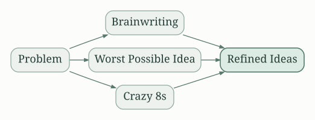
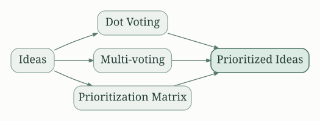
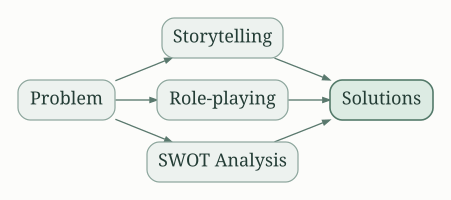

## Gamestorming: Unleashing the Power of Play in Your Organization

Gamestorming by Dave Gray isn't just about games; it's about using game mechanics to improve creativity, collaboration, and problem-solving within teams and organizations. The core message revolves around transforming mundane tasks and strategic sessions into engaging, participatory experiences that generate better outcomes. Gray argues that the playful nature of games encourages risk-taking, experimentation, and a more relaxed approach to tackling complex challenges. This leads to more innovative solutions and stronger team cohesion.

## The Power of Play and its Application

The book emphasizes the power of play. Play allows us to step outside of our comfort zones, experiment without fear of failure, and approach problems with fresh perspectives. By incorporating game mechanics into various contexts, Gray suggests we can harness this power to improve brainstorming, strategic planning, team building, and even personal development. This isn't about childish games; rather, it’s about leveraging the underlying principles of engagement, feedback, and iterative improvement found within games to achieve more effective results.

## Core Principles of Gamestorming

Gray introduces many core principles underlying effective Gamestorming. These include:

* **Iteration:** Gamestorming isn't a one-off event; it's an iterative process of testing, refining, and improving ideas through multiple rounds of play and feedback.

* **Collaboration:**  Gamestorming is inherently collaborative, encouraging participation from all members of the group and valuing various perspectives.

* **Experimentation:** The book champions a culture of experimentation, encouraging participants to try new things, even if they seem unconventional, without fear of judgment.

* **Visualization:** Visual aids, like sticky notes, whiteboards, and physical representations, are important for making ideas tangible and fostering communication.

* **Feedback:**  Gamestorming emphasizes continuous feedback, allowing participants to learn from each other and refine their ideas based on constructive criticism.

## Key Gamestorming Techniques

The book is a collection of practical game-based activities designed to address specific challenges. Here are some key techniques, categorized for clarity:

### Idea Generation and Brainstorming

* **Brainwriting:** A silent brainstorming technique using paper to generate ideas, fostering more various contributions.
* **Worst Possible Idea:**  Starting with the worst possible solution and then working backwards to identify potential improvements, stimulating creative thinking.
* **Crazy 8s:** A rapid sketching technique that encourages quick idea generation, promoting quantity over quality in the initial stages.

### Decision-Making and Prioritization

* **Dot Voting:** A simple and effective way to prioritize ideas based on group consensus through visual voting.
* **Multi-voting:**  A variation of dot voting where participants can vote for multiple items, allowing for a broader range of choices.
* **Prioritization Matrix:**  A visual tool to rank items based on different criteria, enabling informed decisions.

### Problem Solving and Innovation

* **Storytelling:** Using narratives to frame problems and solutions, creating empathy and engaging participants.
* **Role-playing:** Stepping into the shoes of different stakeholders to understand them and anticipate potential challenges.
* **SWOT Analysis (Gamefied):** Transforming the traditional SWOT analysis into a more engaging and participatory activity.

### Team Building and Collaboration

* **Team Canvas:**  A visual tool to define team goals, roles, and processes, fostering alignment and collaboration.
* **Building Blocks:** A collaborative construction task designed to improve communication and problem-solving skills.
* **Human Bingo:** An icebreaker activity that helps team members learn more about each other.

## Actionable Tips for Personal Improvement

While "Gamestorming" primarily focuses on organizational applications, its principles can be effectively applied to personal life.  Here are some key actionable insights:

* **Embrace Playfulness:**  Incorporate playful elements into your daily routine and problem-solving processes.  This might involve brainstorming solutions to everyday challenges in a more creative manner or simply finding more enjoyable ways to approach tasks.

* **Develop a Growth Mindset:** Gamestorming fosters a growth mindset by emphasizing experimentation and learning from mistakes.  Apply this principle to your personal development, welcoming challenges and viewing setbacks as opportunities for growth.

* **Visualize Your Goals:** Use visual aids to plan your goals and track your progress.  This could involve creating mind maps, creating a vision board, or using other visual tools to stay focused and motivated.

* **Seek Feedback:** Actively seek feedback from others on your work and personal endeavors. Constructive criticism can be helpful for self-improvement.

* **Iterate and Adapt:**  View your life as a continuous process of learning and adaptation.  Be willing to adjust your plans and strategies based on new information and feedback.

Gamestorming offers a powerful framework for unlocking creativity, fostering collaboration, and improving problem-solving skills. Its emphasis on playfulness, iteration, and visual communication makes it a tool for both organizational and personal development. By embracing the core principles and techniques outlined in the book, individuals and teams can transform their approach to challenges, achieving more innovative and effective results. The book's strength lies in its practicality; it's a practical guide filled with actionable tools and techniques that can be implemented immediately to improve various aspects of life, both professionally and personally. By adopting the spirit of play and experimentation, individuals can improve their problem-solving capabilities, team dynamics, and personal effectiveness.

