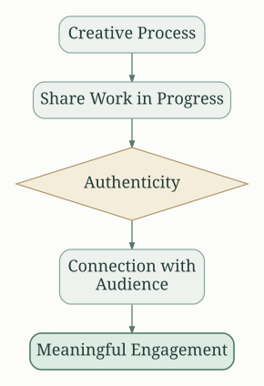
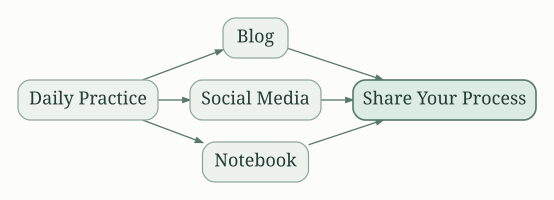
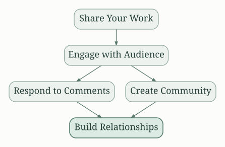
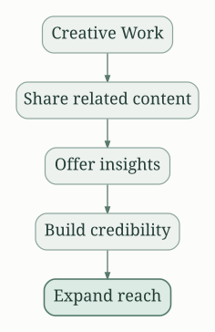
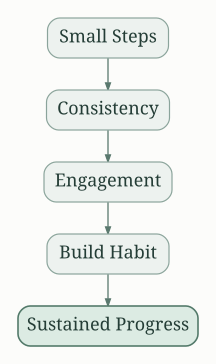
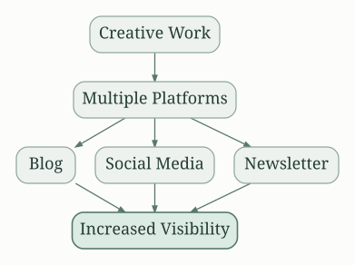
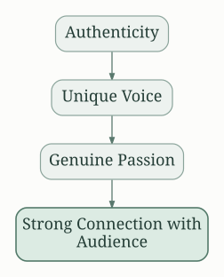

## Show Your Work!: A Summary of Austin Kleon's Guide to Self-Promotion and Creative Living

Austin Kleon's "Show Your Work!" isn't a self-help book in the traditional sense.  It's a manifesto for creative individuals navigating the digital age, offering practical advice on sharing their work and building a meaningful audience.  The core message is simple:  don't hide your process; instead, share it openly and authentically.

## The Importance of Sharing Your Process

Kleon argues against the myth of the solitary genius.  He champions a more collaborative and transparent approach, encouraging readers to document their creative journey. This involves sharing your failures alongside your successes.  Authenticity is key; people connect with the human element, not just the polished final product.

This process fosters trust and allows your audience to understand your creative work on a deeper level, strengthening your connection with them.  It's about building a community around your craft, not just selling your output.

## Document Everything

Kleon stresses the importance of documenting your creative process. This doesn't require a high level of technical skill; a simple blog, social media platform, or even a notebook can suffice. The focus is on consistency; regular updates keep your audience engaged and informed about your progress.

This documentation serves a dual purpose: it not only attracts an audience but also helps solidify your own creative thinking and provides self-reflection opportunities.

## Building an Audience: It's About Relationships, Not Numbers

The book emphasizes the importance of building genuine connections with your audience, rather than chasing superficial metrics like follower count.  Focus on quality interactions; respond to comments, engage in conversations, and genuinely interact with the people who are interested in your work.

This approach fosters a loyal following that's more likely to support your work in the long run, whether through purchases, collaborations, or simply spreading the word. This is organic growth, more than any algorithm-driven boost.

##  Be a Curator, Not Just a Creator

Kleon encourages readers to broaden their engagement by becoming curators of the work they admire.  Share content created by others that inspires you, offering insightful commentary and context.  This establishes you as someone who knows their field, someone worth following for more than just your own creations. This practice enhances your credibility and adds value to your online presence.

This approach builds trust and reinforces the idea that you are part of a larger creative community, rather than a lone operator.

## The Power of Small, Consistent Actions

The book champions consistency over sporadic bursts of activity.  Small, regular updates are far more effective than infrequent, large-scale releases.  This builds anticipation, sustains audience engagement, and cultivates a habit of creative practice.

It's better to share a small piece of your work regularly than to wait for a masterpiece before you engage your audience.  This consistent engagement builds anticipation and establishes a predictable pattern, fostering a loyal following.

## Be a Secret Keeper: The "Scatter"

Kleon encourages readers to diversify their online presence.  Don't put all your eggs in one basket.  Experiment with different platforms, finding where your voice resonates best.  This broad approach increases your visibility and connects you with various audiences.

This "scatter" approach avoids the pitfalls of over-reliance on any single platform and allows for a more flexible and resilient approach to building your audience.

##  Steal Like an Artist: Remix and Reinterpret

Kleon advocates for creative appropriation, arguing that all artists build on the work of those who came before them.  However, he stresses the importance of respectful borrowing, acknowledging your sources and adding your own unique perspective.

## Be Yourself: Your Voice

Authenticity is paramount. Don't try to imitate others; instead, let your unique voice and style shine through in your work and your online presence. Your genuine passion will connect with your audience far more effectively than any attempt at mimicking a trend.

## The Long Game: Patience and Persistence

Building a meaningful audience takes time and effort.  It's a marathon, not a sprint.  Don't get discouraged by slow growth.  Maintain consistency, remain patient, and keep refining your process.

##  Actionable Insights:  A Summary

* **Document your creative process:**  Share your journey, both triumphs and failures.
* **Engage with your audience:** Build relationships, not just numbers.
* **Be a curator:** Share the work of others that inspires you.
* **Diversify your online presence:**  Don't rely on a single platform.
* **Be consistent:** Small, regular updates are more effective than infrequent, large ones.
* **Embrace authenticity:** Be yourself; your unique voice will resonate.
* **Be patient:** Building a meaningful audience takes time.
* **Steal like an artist:** Remix and reinterpret the work of others, respectfully.

"Show Your Work!" isn't just a guide to self-promotion; it's a guide to creative living.  It encourages a shift in mindset, urging readers to collaborate, be transparent, and be authentic in their creative endeavors. By sharing their work and engaging with their audience, individuals can build a fulfilling creative career and create a community around their passions. The key takeaway is not just *how* to share your work but the *why*: to connect with others, build something meaningful, and contribute to a larger creative conversation.

