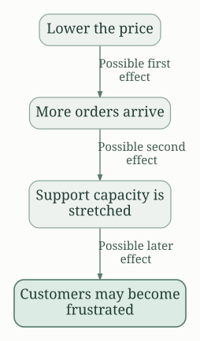
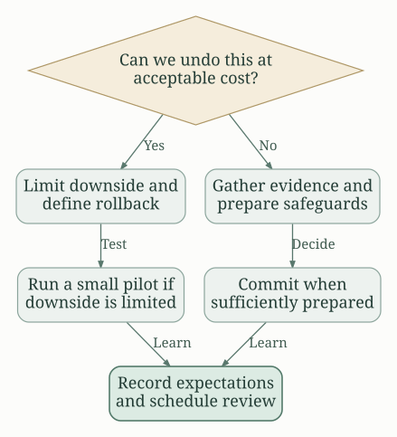

## The central idea: improve the way you approach a problem

A mental model is a simplified way to reason about a situation. Instead of starting from scratch, you ask a useful question: What happens next? What evidence would change my mind? Can I reverse this decision?

Peter Hollins' *Mental Models: 30 Thinking Tools that Separate the Average From the Exceptional* collects tools for choosing, interpreting evidence, solving problems, avoiding mistakes, and allocating attention. Its central promise is a broader thinking toolkit, rather than one technique for every situation. The [publisher's description and book details](https://books.google.com/books?id=ZwygDwAAQBAJ) identify this as the 2019, 30-tool book; Hollins also has other books with similar titles.

**The practical takeaway:** choose a model that fits the problem, use it to expose an assumption, and turn the result into a decision you can review.

This guide gives a compact map of the book, followed by original explanations, examples, and exercises for applying the ideas. The examples and cautions are commentary, rather than stories or quotations from Hollins.

## In this summary

- [The five-part map of the book](#the-five-part-map-of-the-book)
- [1. Make decisions at the right speed](#1-make-decisions-at-the-right-speed)
- [2. Interpret evidence more carefully](#2-interpret-evidence-more-carefully)
- [3. Solve the underlying problem](#3-solve-the-underlying-problem)
- [4. Improve by removing obstacles](#4-improve-by-removing-obstacles)
- [5. Spend effort where it matters](#5-spend-effort-where-it-matters)
- [A worked example: choosing a new work tool](#a-worked-example-choosing-a-new-work-tool)
- [A reusable decision checklist](#a-reusable-decision-checklist)
- [Limitations and common mistakes](#limitations-and-common-mistakes)

## The five-part map of the book

The following topic map follows the numbering in the [book's preview and contents](https://www.everand.com/book/414749580/Mental-Models-30-Thinking-Tools-that-Separate-the-Average-From-the-Exceptional-Improved-Decision-Making-Logical-Analysis-and-Problem-Solving/276260517). Labels are shortened for scanning.

| Part | Models | Topics |
| --- | --- | --- |
| Decisions | 1–6 | Importance versus urgency; downstream consequences; reversibility; satisficing; the 40–70% information heuristic; regret |
| Clearer perception | 7–12 | Black swans; equilibrium; regression to the mean; Bayesian updating; disconfirming evidence; deliberate thinking |
| Problem-solving | 13–18 | Outside perspectives; self-criticism; correlation versus causation; backward causal analysis; SCAMPER; first principles |
| Avoidance | 19–23 | Indirect goals; beginner's mindset; competence boundaries; don't-do lists; resisting easy defaults |
| Established heuristics | 24–30 | Murphy; Occam; Hanlon; Pareto; Sturgeon; Parkinson on expanding work and triviality |

These groups answer different questions. The first concerns *when to decide*. The second concerns *what to believe*. The third concerns *how to investigate*. The fourth concerns *what to stop doing*. The fifth concerns *where to spend effort*.

## 1. Make decisions at the right speed

### Separate importance from urgency

Urgency measures how soon something demands a response. Importance measures what it contributes to an outcome you value. A busy inbox can dominate a day while a consequential, undated task never starts.

**Try it:** list today's tasks, then ask which one would still matter a month from now. Give that task a specific place on your calendar. An urgent and important problem deserves attention; an urgent interruption with little consequence may deserve a short reply, delegation, or no action.

### Think beyond the immediate result

Second-order thinking traces consequences through time and across people. A discount may increase sales immediately, but also reduce margins, change customer expectations, and overload support.

*An attractive first result can hide a costly later effect. These arrows represent plausible consequences to investigate, not guaranteed outcomes.*

**Try it:** draw three steps after your proposed action. At each step, ask who benefits, who pays, and what behavior the action encourages. Include a favorable and an unfavorable path so the exercise does not become an elaborate prediction of just one future.

### Match investigation to reversibility

A temporary experiment and a permanent commitment deserve different amounts of analysis. Before researching another option, establish what it would take to undo the choice.

*Reversibility helps determine the process. A reversible action can still be expensive or harmful, so check the downside separately.*

**Try it:** replace “Should we change everything?” with “What can we test for two weeks, with a spending cap and a rollback plan?” For a choice with lasting consequences, identify the missing evidence that would actually change your answer.

### Define enough before searching for the best

Satisficing means selecting an option that meets explicit requirements. It works best when differences beyond a threshold have little value. Choosing a meeting room rarely deserves the same research as choosing a business partner.

**Try it:** write three must-have criteria and a search deadline before comparing options. Stop when an option meets the criteria, unless the stakes justify a wider search.

Treat the book's 40–70% information idea as a reminder about the cost of delay, not a measurable confidence threshold or universal rule. Ask, “Is the next piece of research likely to change the decision?”

### Use future regret as one perspective

Imagining your future self can reveal that embarrassment, habit, or short-term comfort is driving a choice. It can also romanticize risk.

**Try it:** compare the regret of acting, not acting, and acting on a smaller scale. Pair that reflection with practical constraints such as time, money, and responsibilities.

## 2. Interpret evidence more carefully

### Start with a baseline, then update

Bayesian thinking begins with what was plausible before the latest observation and asks how strongly the new evidence should change that view. A vivid anecdote should not automatically outweigh a consistent pattern.

**Original numerical example:** imagine 100 comparable projects. Historically, 20 finish late. An early warning appears in 15 of those late projects and also in 20 of the 80 projects that finish on time. Among the 35 projects with a warning, 15 finish late: about 43%. The warning meaningfully raises the risk from 20%, but does not make lateness certain.

The useful habit is to ask for both sides: how often does this signal appear when the problem exists, and how often when it does not?

### Distinguish an unusual result from a lasting change

Regression to the mean describes a tendency for unusually high or low observations to be followed by less extreme observations when chance contributes to the result. It does not mean every trend must reverse.

**Try it:** after an exceptional sales week, compare several weeks, customer mix, promotions, and seasonal conditions before declaring a new normal. Likewise, one poor result does not establish a permanent decline.

Equilibrium thinking adds another question: what opposing forces might stabilize the situation? Higher demand can attract competitors, for example. Look for mechanisms and constraints rather than assuming a current rate of change continues indefinitely.

### Make room for evidence you dislike

Confirmation bias becomes harder to sustain when you state in advance what would count against your belief. Deliberate thinking helps when an answer feels obvious mainly because it is familiar or emotionally satisfying.

**Try it:** write your preferred explanation and its strongest alternative. Then name one observation that would distinguish them. Ask a colleague to challenge the reasoning before you reveal which answer you favor.

### Handle rare events without pretending to predict them

The book's black-swan label needs careful interpretation. Unpredictability is a reason to be modest about forecasts, not a reason to dismiss severe risks.

**Practical caution:** concentrate on resilience where precise prediction is unavailable. A backup, spare capacity, or limit on exposure may be more useful than a detailed story about exactly when disruption will occur.

## 3. Solve the underlying problem

### Separate observation, explanation, and intervention

“Customers leave after contacting support” is an observation. “Support causes customers to leave” is a hypothesis. Dissatisfied customers may be more likely both to contact support and to cancel.

**Try it:** identify alternative causes and the order of events. Compare similar groups or run an appropriate small experiment before making a large change. A persuasive narrative is not a substitute for evidence of a causal mechanism.

Backward causal analysis asks what had to happen before the observed result. Keep tracing until you find a cause you can test or influence. Avoid stopping at a label such as “carelessness,” which explains little about how to prevent recurrence.

### Rebuild from first principles

First-principles thinking separates requirements from conventions. It is especially useful when the standard solution is expensive, inherited, or poorly matched to the actual goal.

**Try it:** suppose a team wants to buy a bigger meeting platform. Ask what is truly required: sharing decisions, resolving disagreements, recording ownership, or supporting more participants? Some needs might be met through a written proposal and a shorter meeting.

“Everyone uses this format” is an assumption about practice. “Participants need to know who owns the next action” is a functional requirement.

### Generate alternatives with SCAMPER

SCAMPER is a set of prompts for changing an existing approach: **Substitute, Combine, Adapt, Modify, Put to another use, Eliminate, Reverse or rearrange.**

**Try it on a weekly meeting:** substitute a written update; combine overlapping discussions; adapt an agenda from a better-run team; modify the duration; reuse the notes as onboarding material; eliminate status reports; or reverse the order by collecting decisions before presenting background.

Generating alternatives and evaluating them are separate activities. First create several possibilities, then compare them against the same requirements. Otherwise, the first workable idea can end the search too early.

### Invite a useful challenge

Outside perspectives are most valuable when they expose something specific. “What do you think?” often produces encouragement. “Which assumption is least supported?” produces a more useful conversation.

**Try it:** ask someone with different experience to identify a failure mode, a missing stakeholder, and a cheaper way to test your proposal. Criticize your own preferred answer using the same standards you apply to competing answers.

## 4. Improve by removing obstacles

### Work backward from failure

An outcome goal tells you what success looks like. An avoidance question reveals what would make success unlikely.

**Try it:** for a writing project, list ways to guarantee failure: keep changing the topic, accept every interruption, skip reader feedback, or never set a finish date. Turn the list into concrete boundaries and recurring actions.

This also makes a don't-do list useful. “Be more focused” is vague; “No messaging apps during the first writing hour” changes a behavior you can observe.

### Combine expertise with a beginner's questions

Experience speeds up familiar work, but can make inherited assumptions invisible. A beginner's mindset means being willing to ask basic questions, while competence boundaries remind you where you need help.

**Try it:** divide a decision into what you know from experience, what you infer, and what requires specialist input. Ask an expert to explain a trade-off, rather than asking only for a confident recommendation.

### Make the useful action easier to repeat

The easiest immediate choice can conflict with a long-term goal. Design the situation so that you rely less on repeated acts of willpower.

**Try it:** prepare tomorrow's materials today, remove a recurring distraction, or schedule a review with a clear agenda. Judge these changes by whether they improve behavior over several attempts, rather than whether they feel motivating once.

## 5. Spend effort where it matters

The familiar named laws work best as questions, not literal guarantees.

| Heuristic | A practical question | Boundary to remember |
| --- | --- | --- |
| Murphy | What can fail, and what is our fallback? | Planning for failure does not mean assuming every failure will occur. |
| Occam | Which explanation needs fewer unsupported assumptions? | Simplicity is a starting preference, not proof. |
| Hanlon | Could misunderstanding or error explain this behavior? | Check benign explanations while still responding to evidence of misconduct. |
| Pareto | Which inputs produce most of the useful result? | The distribution need not be exactly 80/20. Measure your situation. |
| Sturgeon | How will we filter for quality? | A memorable percentage is not a measured fact about every field. |
| Parkinson: time | Would a shorter deadline reduce unnecessary work? | Some work needs real time, review, or waiting. |
| Parkinson: triviality | Are we debating easy details while avoiding consequential choices? | Small details sometimes matter; allocate attention according to consequences. |

**Try it:** review a recurring project. Identify one activity to protect, one to shorten, one to stop, and one failure to prepare for. This produces a practical improvement without requiring a complete redesign.

## A worked example: choosing a new work tool

Imagine a small team considering a move to a new project-management application. This is an original example of combining several models.

1. **Define the problem.** “We need a new app” is a proposed solution. “Tasks are regularly missing owners and deadlines” is a problem you can investigate.
2. **Check the cause.** Sample recent missed tasks. Were they caused by missing software features, unclear responsibilities, or people not using the existing process?
3. **Set minimum requirements.** Require visible ownership, due dates, an accessible history, and a workable export. This limits comparison shopping.
4. **Inspect consequences.** Consider migration time, training, subscription costs, and the possibility of splitting records across two systems.
5. **Make a reversible test.** Pilot one project with a limited group. Keep existing records available and establish how to return to the old process.
6. **Define evidence before testing.** Track missing owners, overdue tasks, and time spent maintaining the tool. Compare with a baseline, while recognizing that a small trial may be noisy.
7. **Review and update.** Expand only if the evidence supports it. If ownership remains unclear, fix the process before buying more features.

The models contribute different checks. First principles clarifies the need; causal analysis tests the explanation; satisficing narrows options; second-order thinking exposes costs; reversibility shapes the experiment; and updating determines the next step.

## A reusable decision checklist

Use this for a meaningful choice, not every minor preference.

- **Decision:** What exactly must I choose, and by when?
- **Purpose:** What outcome matters? What would count as good enough?
- **Evidence:** What do I know, what am I assuming, and what is the baseline?
- **Challenge:** What would change my mind? Who sees this differently?
- **Consequences:** What might happen immediately, later, and to other people?
- **Downside:** What can fail? Can I reverse the choice or test a smaller version?
- **Action:** What is the next concrete step, and who owns it?
- **Review:** When will I compare the result with my expectations?

A short decision journal makes the review more honest. Record what you expected *before* the outcome is known. Otherwise, hindsight makes an uncertain choice look inevitable.

## Limitations and common mistakes

**A model simplifies reality.** Its usefulness depends on which details it leaves out. Check whether those omissions matter in your situation.

**Models can conflict.** A shorter deadline can reduce wasted effort, while a high-consequence decision may require more investigation. The task is to choose a proportionate process, not obey every heuristic simultaneously.

**Knowing the name is not applying the idea.** “We used first principles” is less informative than “We removed three assumptions and tested one requirement.” Look for changes in questions, evidence, and action.

**A good outcome does not prove good reasoning.** Luck can reward a weak decision and punish a careful one. Review both the process and the result over multiple decisions.

**More analysis has a cost.** If another model produces no new information or useful action, stop adding frameworks. Use a small set that addresses the actual uncertainty.

## What to practice first

For the next week, use three prompts: **What happens next? What would change my mind? What is the smallest reversible step?** Record one decision using them, then review what you learned.

The lasting value of a mental-model toolkit is the habit of examining your own reasoning. Build that habit through specific decisions, visible assumptions, and feedback.
