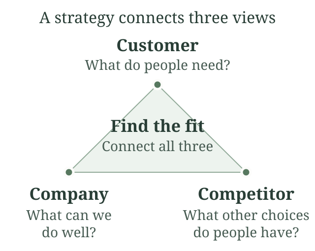
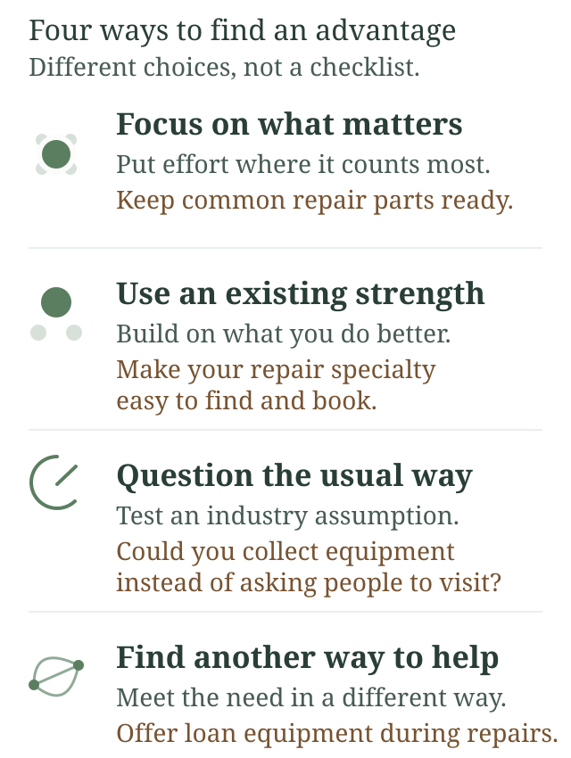

## The Mind of the Strategist: A Summary

Kenichi Ohmae's *The Mind of the Strategist: The Art of Japanese Business* explains how to find a competitive advantage through careful analysis and creative thought. Strategy connects what customers need with what a company can do better than its competitors. Ambition alone does not supply that connection.

The book's main tools include the **strategic triangle** and **four routes to strategic advantage**. Ohmae uses business cases to show how a strategist can examine a situation and find a better way to compete. His purpose is to develop judgment, rather than offer a formula that works in every market. The [publisher's account reproduced in Google Books](https://books.google.com/books/about/The_Mind_Of_The_Strategist_The_Art_of_Ja.html?id=iLMHLIFTg3wC) describes this focus on real companies and patterns of strategic thought.

### Start With Analysis, Then Rebuild the Picture

Ohmae combines detailed analysis with creative synthesis. Analysis separates a problem into parts. Synthesis puts those parts together in a way that reveals possible action. Intuition can suggest a direction, but it needs contact with the facts.

The difference is easier to see in an illustrative case. A repair business says, “We need more sales.” That statement names an outcome. It does not explain the problem. The owner could examine inquiries, bookings, repeat visits, and the time spent on each repair. Perhaps many customers ask for help but leave when they hear the waiting time.

The strategic question then changes. Instead of asking how to advertise more, the owner asks how to offer dependable service sooner. A new advertisement might still help. But changing the booking system could address the actual constraint.

This case and the examples below are illustrations for this summary. They are not Ohmae's case studies.

### The Strategic Triangle: Company, Customer, Competitor

The triangle brings three perspectives into one decision:

- **Customer:** Who needs the service? What result matters to them?
- **Company:** Which skills, resources, and operating choices can deliver that result?
- **Competitor:** What alternatives can the customer choose, and how do they compare?

For the repair business, commuters may value a reliable completion time. Its technicians may already be good at common repairs. A larger rival may offer a wider range of services but have long queues. The smaller company could focus on a narrower set of repairs with dependable collection times.

That choice connects all three sides. It serves a customer need, uses an existing skill, and creates a difference from the rival. The company still needs to check whether customers will pay enough to cover the service. A distinctive offer can fail if it costs too much to provide.

Looking at only one side creates blind spots. Copying a competitor may ignore customers. Following every customer request may exceed the company's ability. Celebrating an internal strength may mean little if customers do not value it. The triangle helps expose these mismatches.

### Four Routes to Strategic Advantage

The [publisher's table of contents](https://www.mheducation.com/highered/mhp/product/mind-strategist-art-japanese-business.html) identifies four routes. They are ways to search for advantage, rather than four steps every company must complete.

#### 1. Focus on Key Factors for Success

Identify the activities that matter most to success in a particular business. Concentrate scarce resources there. Spreading effort evenly can leave the decisive weakness untouched.

In the repair example, timely access to common spare parts might matter more than a larger reception area. The owner should test that belief against missed deadlines and customer feedback. If missing parts cause delays, improving stock availability deserves attention. If diagnosis is the bottleneck, extra stock may accomplish little.

The practical lesson is to find what makes the difference before deciding where to invest.

#### 2. Build on Relative Superiority

Look for an advantage over competitors that the company already has or can use more effectively. Superiority is relative to an alternative and a customer need. A company does not need to lead in every activity.

Suppose the repair shop has strong diagnostic skills for one type of equipment. It could make that specialty easier to find and book. Trying to match a large rival's entire service range could dilute the strength that makes the smaller business useful.

A useful comparison asks: better for whom, at what task, and at what cost?

#### 3. Pursue Aggressive Initiatives

Question the assumptions that keep an industry working in a familiar way. This route seeks a change in the basis of competition. “Aggressive” here concerns challenging established practice, rather than simply working harder or cutting prices.

Suppose every local repair shop expects customers to bring equipment in during office hours. A collection service might change the offer. It would also introduce travel, scheduling, and handling costs. The owner needs to examine those costs before treating the idea as an advantage.

Challenging a convention starts an investigation. It does not prove the convention is wrong.

#### 4. Explore Strategic Degrees of Freedom

Look for the dimensions along which the business can change its offer to meet a customer objective. These are its strategic degrees of freedom. Begin with the benefit sought, then consider alternative ways to deliver it.

A customer may want less disruption from broken equipment. Faster repairs are one response. Loan equipment, scheduled maintenance, or on-site service could also address that need. Each option uses different resources and faces different constraints.

This route encourages more than adding features to an existing product. Ohmae's later article [“Getting back to strategy,” reprinted by McKinsey](https://www.mckinsey.com/~/media/McKinsey/Business%20Functions/Strategy%20and%20Corporate%20Finance/Our%20Insights/Delivering%20value%20to%20customers/Delivering%20value%20to%20customers.pdf), reinforces the importance of starting with customer needs and examining the company's freedom to respond.

### Turn a Strategic Idea Into a Testable Choice

The following questions apply the frameworks. They are a reading aid, rather than a separate model attributed to Ohmae:

1. Which customer group are we choosing to serve?
2. What need matters enough to shape that choice?
3. Which company strength can meet it?
4. How is the offer better than the customer's alternatives?
5. What will we concentrate on, and what will we decline?
6. What evidence would make us reconsider?

For the repair shop, a clear choice might be to prioritize common repairs for local commuters. The owner could track whether promised collection times are met and whether customers return. Poor results would prompt another look at the assumptions. They would not automatically mean that more advertising is needed.

### How to Read the Book Today

Ohmae writes about business strategy through the industrial and competitive setting of his time. Historical examples show how he reasons. They do not establish what will succeed in a current market. Readers must check present customer needs, costs, technology, and competing offers for themselves.

The lasting value is a disciplined habit of inquiry. Break down a vague problem. Search for the factors that matter. Reconnect customer needs, company strengths, and competitive alternatives. Then make a focused choice that the business can carry out.

### Sources

- [McGraw Hill: book details and table of contents](https://www.mheducation.com/highered/mhp/product/mind-strategist-art-japanese-business.html) — author, book structure, and four routes to advantage.
- [Google Books: publisher description and bibliographic record](https://books.google.com/books/about/The_Mind_Of_The_Strategist_The_Art_of_Ja.html?id=iLMHLIFTg3wC) — the strategic triangle and the book's purpose.
- [Ohmae seminar brochure](https://bbb.com.gr/wp-content/uploads/2015/05/Brochure_KENICHI-english.pdf) — his explanations of key success factors, relative advantage, and strategic degrees of freedom.
- [Kenichi Ohmae: “Getting back to strategy,” McKinsey reprint](https://www.mckinsey.com/~/media/McKinsey/Business%20Functions/Strategy%20and%20Corporate%20Finance/Our%20Insights/Delivering%20value%20to%20customers/Delivering%20value%20to%20customers.pdf) — supplementary author writing on customer needs; this is a later article, not an excerpt from the book.
