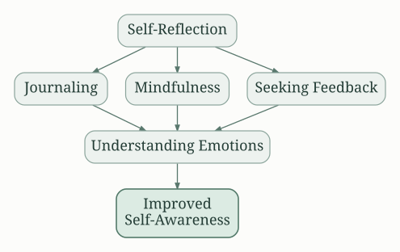
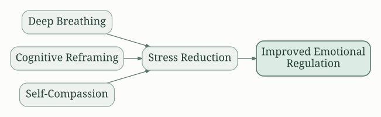
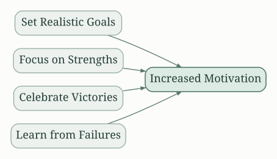
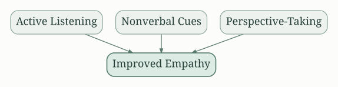
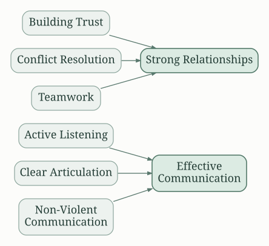
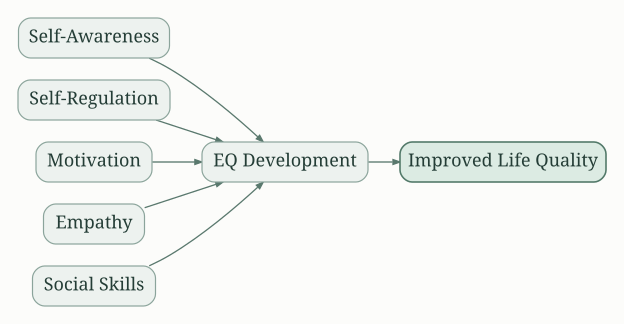

# Understanding Emotional Intelligence (EQ)

"Emotional Intelligence 2.0" posits that emotional intelligence (EQ) is a learnable skill set for personal and professional success. Unlike IQ, which measures cognitive abilities, EQ focuses on understanding and managing your own emotions and those of others. The book argues that high EQ individuals are more likely to build strong relationships, achieve their goals, and lead fulfilling lives. Improving your EQ requires self-awareness, self-regulation, motivation, empathy, and social skills.

# Self-Awareness: Knowing Yourself

This foundational element involves understanding your emotions, strengths, weaknesses, values, and how you impact others. The book stresses the importance of self-reflection and suggests techniques like journaling, mindfulness, and seeking feedback from trusted individuals to gain a clearer picture of yourself. Ignoring your emotions is detrimental; understanding them helps you anticipate reactions in different situations and understand your decision-making process.

# Self-Regulation: Managing Your Emotions

Self-regulation involves controlling impulsive behaviors, managing stress, and adapting to changing circumstances.  The authors propose strategies such as deep breathing exercises, cognitive reframing (changing negative thoughts into positive ones), and practicing self-compassion.  Developing this skill reduces emotional reactivity and enables more constructive responses to challenging situations.

# Motivation: Your Internal Drive

Motivation is the force that drives you to achieve your goals.  High EQ individuals exhibit intrinsic motivation, driven by a sense of purpose and passion rather than solely external rewards.  The book advises setting realistic goals, focusing on your strengths, celebrating small victories, and learning from failures to maintain a positive and productive mindset.

# Empathy: Understanding Others

Empathy involves understanding and sharing the feelings of others. It's about actively listening, paying attention to nonverbal cues, and considering different perspectives.  The authors stress the importance of perspective-taking to improve communication and build strong relationships.  Empathy isn't about agreeing with others but about understanding their emotional landscape.

# Social Skills: Building Relationships

Social skills include communication, conflict resolution, teamwork, and leadership. The book provides practical strategies for effective communication, such as active listening, clear articulation, and non-violent communication.  It also emphasizes the importance of building trust and rapport, managing conflict constructively, and leveraging the strengths of team members.

# Putting It All Together: The EQ Model

The book presents a practical framework for improving emotional intelligence, focusing on building self-awareness, self-regulation, motivation, empathy, and social skills.  The authors suggest regular self-assessment, goal setting, and consistent practice to develop these skills.  They argue that consistent effort leads to significant improvements in personal and professional life.  The model presented encourages an approach to personal development.

# Actionable Strategies:

* **Self-Assessment:** Regularly assess your emotional intelligence using the tools and questionnaires provided in the book. Identify areas for improvement and set specific, measurable, achievable, relevant, and time-bound (SMART) goals.
* **Mindfulness Practices:** Incorporate mindfulness techniques like meditation or deep breathing into your daily routine to improve self-awareness and emotional regulation.
* **Journaling:** Regularly reflect on your experiences, emotions, and reactions in a journal to gain understanding of your behavior patterns.
* **Feedback Seeking:** Actively seek feedback from trusted individuals to gain a broader perspective on your strengths and weaknesses.
* **Cognitive Reframing:**  Challenge negative thought patterns by consciously replacing them with more positive and realistic ones.
* **Emotional Vocabulary:** Expand your emotional vocabulary to better articulate your feelings and understand the emotions of others.
* **Active Listening:** Practice active listening techniques, such as paraphrasing and reflecting, to improve communication and empathy.
* **Nonviolent Communication:**  Learn and apply the principles of nonviolent communication to resolve conflicts peacefully and effectively.
* **Goal Setting:**  Set clear, achievable goals and break them down into smaller, manageable steps.
* **Celebration of Successes:** Celebrate your accomplishments, no matter how small, to maintain motivation and positive self-perception.

## A Journey of Self-Improvement

"Emotional Intelligence 2.0" is not merely a self-help book but a practical guide to improving your life through self-awareness and emotional mastery. The authors' emphasis on actionable strategies and tools makes the book's advice readily applicable to everyday situations. By consistently practicing the principles and techniques outlined in the book, readers can improve their emotional intelligence, leading to more fulfilling relationships, greater success in their careers, and a more balanced and harmonious life. It's a journey of continuous self-improvement, requiring commitment and consistent effort, but the rewards are well worth the investment.

