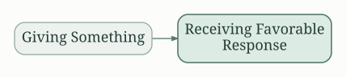
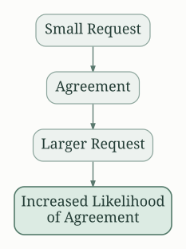
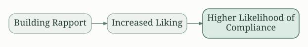
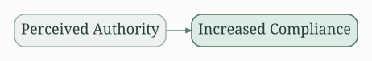
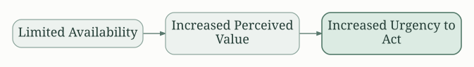
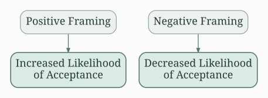

# Understanding the Science of Persuasion

"Yes!: 50 Scientifically Proven Ways to Be Persuasive" by Noah J. Goldstein, Steve J. Martin, and Robert B. Cialdini isn't just about manipulation; it's about understanding the psychological principles that drive human behavior and leveraging them to achieve mutually beneficial outcomes. The book dissects persuasion, offering actionable advice grounded in scientific research. It emphasizes ethical persuasion, focusing on techniques that benefit both the persuader and the persuadee.

# Reciprocity: The Power of Giving First

Reciprocity, the principle of returning favors, is a cornerstone of persuasion. Giving something first, whether it's a small gift, a thoughtful compliment, or helpful information, increases the likelihood of receiving something in return. This doesn't necessitate grand gestures; even small acts of kindness can trigger a powerful reciprocal response.

The authors highlight the importance of personalization and making the initial gift relevant to the recipient's needs and interests. This makes the gesture more meaningful and strengthens the reciprocal bond.

# Commitment and Consistency: The Foot-in-the-Door Technique

Once someone commits to something, even something small, they're more likely to stay consistent with that commitment.  The "foot-in-the-door" technique capitalizes on this by starting with a small request, which most people readily agree to. This initial commitment paves the way for larger, related requests later on.

The key is to ensure that the subsequent requests are logically connected to the initial commitment.  A sudden shift to an unrelated request would break the consistency and undermine the technique's effectiveness.

# Social Proof: The Power of Conformity

People often look to others for cues on how to behave, especially in uncertain situations. This is the principle of social proof. Highlighting the popularity or widespread acceptance of something increases its appeal. Testimonials, reviews, and statistics showing widespread adoption are powerful tools in leveraging social proof.

The authors highlight the importance of targeting the right audience. Social proof is most effective when it comes from similar others – individuals whom the target audience identifies with and respects.

# Liking: Building Rapport for Influence

People are more likely to say "yes" to those they like. Building rapport and establishing a connection is important for successful persuasion. Similarity, compliments, cooperation, and physical attractiveness all play a role in enhancing likability.

The book suggests focusing on shared interests, finding common ground, and genuinely showing interest in the other person.  Authenticity is key; insincere attempts at flattery are easily detectable and counterproductive.

# Authority: The Impact of Credibility

People tend to obey authority figures, even if those figures are not inherently more knowledgeable or skilled.  This doesn't endorse blind obedience; rather, it highlights the importance of establishing credibility and expertise.

Demonstrating credentials, evidence, and confident communication increases persuasiveness. However, the authors caution against exploiting this principle unethically. Authority should be earned, not fabricated.

# Scarcity: The Power of Limited Availability

Limited availability increases the perceived value of something.  This principle is often used in marketing through phrases like "limited-time offer" or "while supplies last." The feeling of potential loss motivates people to act quickly.

The authors warn against overusing scarcity tactics, as overuse can lead to suspicion and distrust.  The scarcity must be genuine and presented subtly to be effective.

# Framing: Shaping Perception Through Language

How information is presented, or "framed," impacts its interpretation and acceptance.  Framing involves strategically choosing words and highlighting specific aspects of a situation to influence the listener's perception.  For instance, highlighting potential gains is often more effective than emphasizing potential losses.

The book provides numerous examples of how framing can influence choices, even when the underlying facts remain unchanged. Understanding framing enables one to craft persuasive messages for the target audience.

#  Utilizing  the Principles  Ethically

The book strongly emphasizes the ethical application of these principles.  Persuasion is not about manipulation; it's about influencing behavior in a way that benefits both parties involved.  Exploiting psychological principles for selfish gain is both unethical and ultimately unsustainable.

The authors consistently stress the importance of building trust, respecting autonomy, and focusing on mutually beneficial outcomes.  Persuasion, when used responsibly, can be a powerful tool for achieving positive change and fostering collaboration.

# Actionable Conclusion

Yes! offers actionable advice for professional and personal settings. It empowers readers to navigate social interactions more effectively, build stronger relationships, and achieve their goals by understanding the underlying psychological principles of human behavior. The book provides a framework for ethical and effective persuasion, urging readers to consider the ethics of their actions and prioritize mutual benefit. By employing these principles responsibly, readers can improve their ability to influence others and achieve their objectives while maintaining integrity. The combination of scientific evidence and practical advice makes this book a resource for anyone seeking to improve their persuasive skills.

