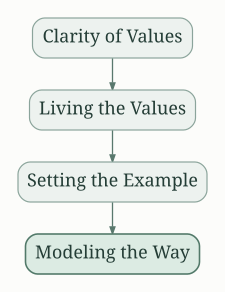
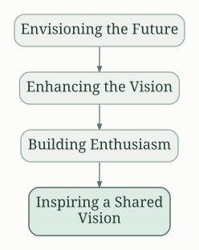
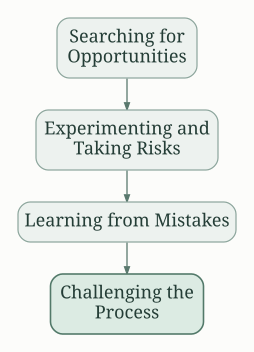
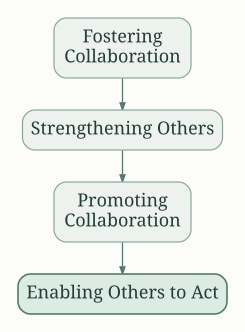

## The Essence of Exemplary Leadership

"The Leadership Challenge" by James M. Kouzes and Barry Z. Posner isn't just a leadership textbook; it's a practical guide for anyone seeking to improve their influence and effectiveness, both professionally and personally.  The book's core argument rests on the idea that leadership is not a position, but a practice – a set of behaviors anyone can learn and cultivate.  It emphasizes the importance of personal example and inspires readers to become better leaders by modeling exemplary behaviors.

## The Five Practices of Exemplary Leadership

The authors distill exemplary leadership into five core practices, each further broken down into specific behaviors.  These practices are not sequential steps but interconnected elements that work synergistically:

### Modeling the Way

This practice emphasizes leading by example. Exemplary leaders align actions with values, build credibility, and demonstrate a commitment to their principles. This involves:

* **Clarity of Values:** Defining and communicating a clear set of values that guide decisions and actions.
* **Living the Values:** Consistently acting in accordance with those values, showing integrity and authenticity.
* **Setting the Example:** Demonstrating the desired behaviors and attitudes, inspiring others to follow suit.

### Inspiring a Shared Vision

Leaders need to articulate a compelling vision that inspires and motivates others.  This requires:

* **Envisioning the Future:**  Creating a clear and compelling picture of a desired future state.
* **Enhancing the Vision:**  Communicating the vision in a way that resonates with people's values and aspirations.
* **Building Enthusiasm:**  Instilling a sense of excitement and shared purpose among team members.

### Challenging the Process

Exemplary leaders are not afraid to take risks, experiment, and learn from failures.  This involves:

* **Searching for Opportunities:** Actively seeking out new challenges and opportunities for improvement.
* **Experimenting and Taking Risks:**  Being willing to try new things, even if it means facing potential setbacks.
* **Learning from Mistakes:**  Viewing failures as learning opportunities and adapting strategies accordingly.

### Enabling Others to Act

Effective leaders foster collaboration, trust, and mutual respect in their team members. This encompasses:

* **Fostering Collaboration:**  Creating an environment where people feel comfortable working together and sharing ideas.
* **Strengthening Others:**  Providing support, resources, and guidance to help others develop their skills and capabilities.
* **Promoting Collaboration:**  Encouraging teamwork and shared responsibility.

### Encouraging the Heart

This practice focuses on recognizing and appreciating contributions, building relationships, and celebrating successes.  This involves:

* **Celebrating Accomplishments:**  Acknowledging and rewarding both individual and team achievements.
* **Creating a Positive Climate:**  Building a supportive and encouraging work environment.
* **Building Relationships:**  Developing strong, positive relationships with team members.

## Actionable Strategies

The book isn't just theoretical; it provides numerous actionable strategies.  It emphasizes the importance of self-reflection and encourages readers to identify their strengths and weaknesses.  The authors suggest using self-assessment tools and seeking feedback from others to understand how they are perceived as leaders.

The book promotes continuous learning. It highlights the importance of observing and learning from other exemplary leaders and adapting their approaches to fit your unique circumstances. Readers are encouraged to actively seek out mentors and role models. Furthermore, the book emphasizes the power of storytelling in inspiring and motivating others. Sharing personal stories and examples can build trust and connection, making a vision more relatable.

## Personal Application Beyond Leadership Roles

The principles in "The Leadership Challenge" transcend formal leadership positions.  The five practices, when applied consistently, can dramatically improve personal effectiveness in all aspects of life.  For example:

* **Modeling the Way:**  Living your personal values consistently,  demonstrating integrity in your daily actions.
* **Inspiring a Shared Vision:**  Setting personal goals and inspiring yourself and others to achieve them.
* **Challenging the Process:**  Stepping outside your comfort zone, trying new things, and embracing continuous personal growth.
* **Enabling Others to Act:**  Supporting and empowering family, friends, or colleagues to reach their potential.
* **Encouraging the Heart:**  Celebrating personal milestones, practicing gratitude, and building positive relationships.

By internalizing and applying these principles, readers can become more effective communicators, collaborators, and problem solvers, ultimately improving their personal and professional lives.  The book serves as a constant reminder that leadership isn't about titles or authority; it's about inspiring and empowering others to achieve shared goals, starting with oneself.  The consistent practice of the five practices is what truly distinguishes exemplary leadership, making the book a resource for lifelong personal and professional development.

