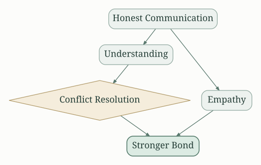
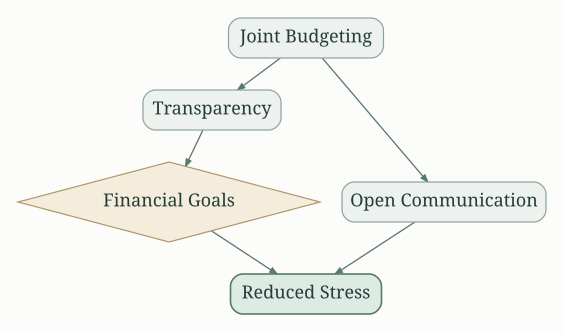
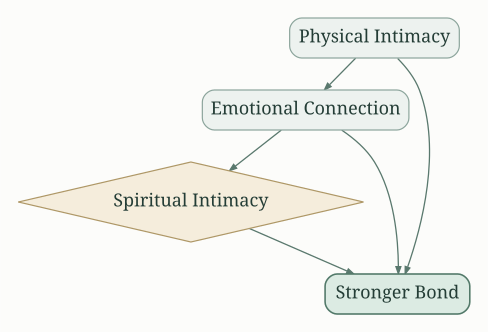
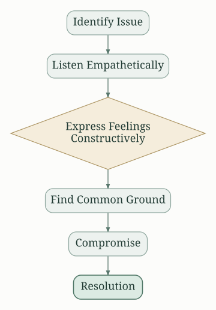
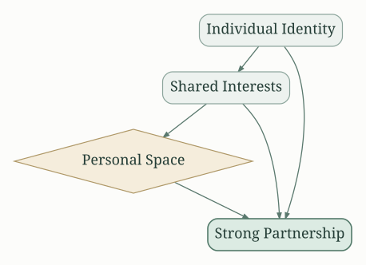
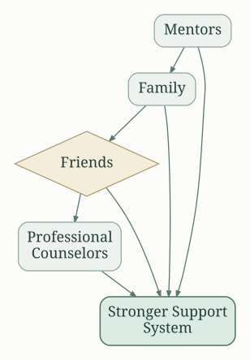

## First Year of Marriage: A Summary of Key Advice and Strategies

Marcus and Ashley Willis' "First Year of Marriage" offers a practical and insightful guide for navigating the challenges and joys of newlywed life.  Their approach is grounded in personal experience, biblical principles, and a commitment to building a strong, healthy relationship. The book isn't a theoretical treatise; it's a toolbox filled with actionable advice and strategies designed to help couples thrive during a period of adjustment and growth.

### Understanding the Transition

The book emphasizes the significant transition couples undergo during their first year of marriage. It's not just a change of living arrangements; it's a merging of two distinct lives, personalities, and expectations. The Willises highlight the importance of acknowledging this transition and proactively addressing the potential challenges it presents.  They stress that unrealistic expectations are a major source of conflict and disappointment.

### Communication: The Cornerstone of a Thriving Marriage

Effective communication is repeatedly emphasized as the cornerstone of a successful marriage.  The book provides practical strategies for improving communication skills, including active listening, empathetic responses, and clear, respectful expression of needs and feelings.

The Willises underscore the importance of avoiding accusatory language and focusing on "I" statements to express concerns without placing blame.  They encourage couples to schedule regular "check-in" times to discuss their relationship and address any emerging issues before they escalate.

### Managing Finances: A Joint Venture

Financial matters are frequently a source of stress and conflict in marriages. The book offers advice on developing a joint financial plan, including budgeting, debt management, and setting shared financial goals. Transparency and open communication about finances are important to avoid resentment and conflict.

The Willises advocate for creating a unified financial strategy that reflects both partners’ values and priorities, avoiding the "his" and "hers" approach to finances.  They suggest setting aside time to discuss spending habits and develop a plan that works for both individuals.

###  Navigating Intimacy:  Beyond the Physical

The book addresses the complexities of intimacy in marriage, extending beyond the physical aspect to emotional and spiritual connection. It emphasizes the importance of nurturing affection, understanding each other's love languages, and prioritizing quality time together.

The Willises encourage open and honest communication about sexual expectations and desires, emphasizing mutual respect and understanding. They highlight the importance of physical affection and intimacy as expressions of love and connection.  They also stress the significance of spiritual intimacy, suggesting shared prayer, Bible study, or other spiritually enriching activities.

###  Conflict Resolution:  A Necessary Skill

Disagreements are inevitable in any relationship.  The book provides practical strategies for resolving conflicts constructively, emphasizing compromise, empathy, and forgiveness.  It encourages couples to approach disagreements as opportunities for growth and understanding rather than personal attacks.

The Willises advise avoiding escalation, focusing on the underlying issue, and seeking to understand each other's perspective before attempting to resolve the conflict.  They suggest using "I" statements to express concerns and actively listening to your partner's viewpoint.  They also advise the importance of forgiveness and moving forward after a conflict.

###  Maintaining Individuality While Building a Team

The book acknowledges the importance of maintaining individual identities while building a strong partnership.  It emphasizes the need for healthy boundaries, personal space, and pursuing individual interests and hobbies.

This balance, they argue, prevents codependency and fosters a stronger and more fulfilling relationship.  It encourages couples to support each other’s personal growth and development.

###  Seeking External Support:  Building a Community

The Willises highlight the importance of building a supportive community. They encourage couples to seek guidance from mentors, trusted friends, family members, and potentially even professional counselors.

They acknowledge that seeking external support is a sign of strength, not weakness, and that a strong support network contributes to a successful marriage.

###  The Role of Faith:  A Guiding Principle (if applicable)

For readers who share the Willises' Christian faith, the book integrates biblical principles throughout. It highlights the role of faith in providing a foundation for building a strong and lasting marriage, emphasizing prayer, forgiveness, and commitment. This section provides spiritual guidance for those who find it relevant to their relationship. However, the core advice regarding communication, finances, and conflict resolution is applicable to couples of all faiths or no faith at all.

###  Long-Term Vision:  Building for the Future

The Willises encourage couples to develop a shared vision for their future together. This involves setting long-term goals, both personal and marital, and working together to achieve them.  This includes planning for future milestones like having children or pursuing career aspirations.  Having a common understanding of the future strengthens the bond and reinforces the commitment to the marriage.

### Actionable Takeaways

"First Year of Marriage" is not just a book to be read; it's a resource to be actively used. The Willises provide numerous actionable insights, including practical exercises and discussions designed to improve understanding and communication between partners. The book encourages self-reflection, honest dialogue, and a proactive approach to problem-solving. It emphasizes the importance of ongoing effort and commitment to building a thriving and fulfilling marriage. It’s a constant reminder that marriage is a journey, not a destination, and requires ongoing investment and understanding.  By implementing the strategies and advice offered, couples can improve their chances of navigating the first year and beyond successfully.

