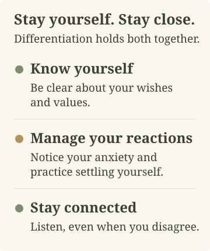
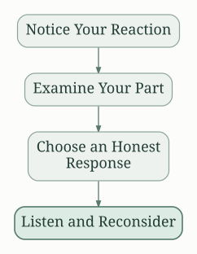

## Passionate Marriage: A Summary

David Schnarch's *Passionate Marriage* connects personal growth with emotional and sexual intimacy. Its central idea is **differentiation**: developing a clear sense of self while staying close to a partner. In Schnarch's account, a lasting relationship can help people develop this ability. Passion need not depend only on the novelty of early romance.

The book uses detailed accounts of couples in therapy. It asks readers to examine how they respond to closeness, disagreement, and sexual vulnerability. New techniques alone cannot answer these questions. The task is to become more able to know yourself and let your partner know you. This is Schnarch's clinical perspective, rather than a promise that every couple will get the same result. [Norton's description](https://wwnorton.co.uk/books/9780393040210-passionate-marriage-dbb4f521-b256-4f05-b367-3b2389812920) explains this link between sexual encounters and the wider relationship.

### Differentiation: Stay Yourself While Staying Close

Differentiation combines two capacities that can seem opposed. You can care about your partner's feelings and still think for yourself. You can remain involved without making agreement the price of connection.

Emotional *fusion* describes the opposite pattern. Your sense of worth depends heavily on your partner's response. Disagreement then feels like a threat to who you are. Physical distance may reduce immediate tension, but distance alone does not change that dependence.

Managing your reactions means noticing anxiety without making your partner responsible for removing it. You can pause to settle yourself, then return to the discussion.

Consider an illustrative disagreement about a job offer. One partner wants to move. The other wants to stay near family. Giving up the offer without discussion may hide resentment. Dismissing family ties may protect one person's wishes at the cost of the relationship. A different response is to state both concerns clearly and remain available for a difficult discussion. There may still be no easy answer. The aim is to face the choice without erasing either person.

This example is an application of the idea, not a case from the book.

### Intimacy and the Need for Approval

Schnarch distinguishes intimacy that depends on a partner's approval from intimacy based on validating yourself. In the second form, you reveal something true without requiring a comforting response. Your partner may disagree. Their response still matters, but it does not decide your worth.

For example, imagine admitting, “I often agree because I am afraid you will be disappointed.” A request for immediate praise can shut down the discussion. A willingness to hear the partner's experience leaves room for new information. Perhaps the partner has felt shut out by those repeated agreements.

Self-validation does not mean that your view is always correct. You can accept criticism and change your behavior. The distinction is between examining feedback and treating every negative reaction as a verdict on your value. These ideas and the account of fusion above follow [Schnarch's explanation of differentiation and intimacy](https://www.bemindful.org/articles/schnarchintrvw.htm).

### Gridlock and the Limits of Communication Skills

Schnarch calls a persistent emotional standoff *gridlock*. He sees it as a possible pressure for growth. Better wording cannot resolve every disagreement. Sometimes both people understand the message and dislike the choice it presents.

Imagine one partner saying, “I want more time together,” while the other wants more time alone. Both requests can be clear. Repeating them more forcefully does not settle the issue. Useful questions include: Am I asking for closeness, or proof that I matter? Am I asking for time alone, or avoiding an honest conversation?

These questions illustrate how self-examination can change a discussion. They do not identify which partner is right. Nor do they make conflict valuable in itself. An argument can repeat the same pattern without producing insight.

### Sexual Passion and Emotional Contact

The book treats sexual encounters as part of the whole relationship. A kiss or a familiar sexual routine can express affection. It can also conceal anxiety about being seen or taking initiative. Schnarch asks couples to examine the meaning of their interactions, rather than judge them only by physical performance.

His larger argument is hopeful about long relationships. Greater maturity may allow more emotional and sexual fulfillment later in life. That is the book's proposition, not a universal timetable. Its emphasis is on developing connection with a known partner, rather than trying to recreate the uncertainty of a new romance. The [publisher's updated-edition description](https://wwnorton.co.uk/books/9780393334272-passionate-marriage) makes this aim explicit.

### Tools for Connection

One exercise associated with the book is **hugging until relaxed**. Each person stands balanced on their own feet. They come together in a comfortable embrace and attend to their own breathing and tension. The purpose is to notice what happens during contact and practice settling yourself while remaining close.

The physical arrangement expresses the larger idea: two people can support their own balance and still connect. It also gives them something concrete to discuss afterward. Did either person feel hurried, guarded, distracted, or responsible for the other's comfort?

Schnarch's connection exercises also include eye contact. These practices direct attention toward the person present, rather than toward a performance goal. The [“Six Tips” handout](https://www.integralpsychology.org/uploads/1/5/3/0/15300482/_six_tips_for_creating_a_more_passionate_relationship.pdf) describes the hug and related practices. Any shared exercise needs both people's willing participation. Discomfort is information to discuss, not an instruction to override a boundary.

### Applying the Ideas Without Turning Them Into Demands

The following is an illustrative reflection process, not a sequence of stages from the book:

1. **Notice the reaction.** What happened just before you began to defend, withdraw, or seek reassurance?
2. **Examine your part.** What did you leave unsaid? What response were you trying to obtain?
3. **Choose an honest response.** State a wish or limit without claiming to know your partner's motives.
4. **Listen and reconsider.** Allow the answer to add information, even when it is disappointing.

The book's useful challenge is personal responsibility. It loses that value when someone uses “differentiate” to mean “stop objecting to what I want.” A partner remains a separate person with separate choices. More self-knowledge does not guarantee agreement or preserve every relationship.

Read *Passionate Marriage* as a demanding account of growth through intimacy. Its strongest question is practical: can you become more honest and steady while remaining open to another person?

### Sources

- [W. W. Norton: original-edition description](https://wwnorton.co.uk/books/9780393040210-passionate-marriage-dbb4f521-b256-4f05-b367-3b2389812920) — book identity, clinical examples, and central thesis.
- [W. W. Norton: updated edition](https://wwnorton.co.uk/books/9780393334272-passionate-marriage) — the book's focus on intimacy across a long relationship.
- [Interview with David Schnarch, hosted by John S. Shealy](https://www.bemindful.org/articles/schnarchintrvw.htm) — the author's explanations of differentiation, self-validation, and gridlock.
- [Six Tips for Creating a More Passionate Relationship](https://www.integralpsychology.org/uploads/1/5/3/0/15300482/_six_tips_for_creating_a_more_passionate_relationship.pdf) — connection exercises linked to Schnarch's books.
