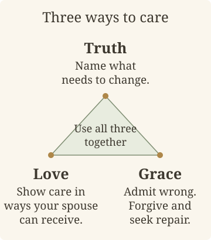

# The Meaning of Marriage: Summary and Key Ideas

Timothy Keller's *The Meaning of Marriage: Facing the Complexities of Commitment with the Wisdom of God* presents marriage as a lifelong covenant that helps two people grow in love and character. Published in 2011, it draws on his marriage to Kathy Keller, their pastoral work, and their reading of the Bible. Kathy helped write the book and wrote the chapter on gender differences.

The book addresses married people, single people, and those considering marriage. Its main aim is to explain a Christian vision of marriage. Readers from other backgrounds can examine its ideas, but faith supplies the foundation of its argument. The [publisher's introduction](https://www.penguinrandomhouseretail.com/book/?isbn=9780525952473) makes that purpose clear.

## The central idea: marriage reflects the gospel

Keller builds his account around Ephesians 5 and Genesis 2. He reads marriage through the Christian belief that Christ loves and gives himself for the Church. For Keller, this love both explains marriage and provides the power to sustain it.

This is more than an instruction to copy a good example. Keller argues that people need the Holy Spirit's help to overcome self-centeredness. Receiving God's grace should make them more able to serve another person. The book's [own outline](https://www.thegospelcoalition.org/blogs/justin-taylor/an-outline-of-the-kellers-book-on-marriage/) places this claim at the heart of its account of marital change.

That distinction matters. Keller's proposed source of change is a relationship with God. His account includes practical skills, but those skills belong within a theological argument.

## Covenant: a promise that outlasts changing feelings

A **covenant** is a binding promise to share a whole life. It includes emotional, physical, financial, legal, and spiritual commitments. This is the book's central term for marriage.

The Kellers argue that such a promise gives intimacy room to deepen. Feelings rise and fall. A lasting commitment lets two people remain open to each other through those changes. Love includes both affection and chosen actions. Their [later recap of the original book](https://timothykeller.com/blog/2019/11/12/introduction-to-the-meaning-of-marriage-a-couples-devotional) explains this connection between promise and trust.

Consider an ordinary example: one spouse feels distant after a tiring week. Keeping an agreed evening together can express care before warm feelings return. This illustrates the distinction between feeling love and acting lovingly. It is not an episode from the book.

## Spiritual friendship: helping each other grow

Keller treats marriage as a friendship with a shared purpose. Spouses help each other become the people God intends them to be. **Sanctification** is the Christian term for this growth toward Christlike character.

Romance and friendship belong together in this account. In the [sermon series behind the book](https://marriage.gospelinlife.com/e/marriage-as-friendship/), Keller describes friends as people traveling toward a common horizon. Marriage gives that shared journey a lasting form.

This changes what compatibility means. Shared interests can make time together pleasant. A shared direction also helps a couple decide what to do when interests, circumstances, or abilities change. For example, a couple who value hospitality may need to change how they welcome others after illness or a move. The activity changes; the purpose can remain.

The book therefore asks readers to look beyond immediate attraction. Can these two people become close friends? Can they encourage each other's growth? What will they work toward together?

## Truth, love, and grace in daily life

The Kellers identify three ways to know and love a spouse: truth, love, and grace. Their author-site recap names these as the practical tools of the original book.

*These are three practices to combine, rather than steps that guarantee an outcome.*

**Truth** brings problems into the open. **Love** expresses care in ways that matter to the other person. **Grace** includes repentance, forgiveness, and reconciliation. Repentance means acknowledging wrongdoing and turning away from it.

For an illustrative example, imagine repeated lateness to a shared meal. Truth means describing what happened without turning it into a claim that the other person always fails. Love means asking why the meal matters to each spouse. Grace includes an honest apology and an effort to repair the pattern.

This example shows why all three matter. Naming a problem can help a couple face it. Care can help them hear each other. Repair requires more than winning the argument. These applications explain the framework; they are not quotations or a formal script from the book.

## Differences, gender roles, and sex

Kathy Keller's chapter on accepting the other person gives the book's account of gender roles. The Kellers hold a **complementarian** view: women and men have equal worth and distinct marital roles. They understand the husband's headship and the wife's submission through Christ's self-giving love. Both spouses have duties of service. They allow variation in how couples express those roles in daily life.

This is a specific theological position. Readers should distinguish it from the broader observation that spouses have different personalities or habits. Gavin Ortlund's [review of the book](https://www.thegospelcoalition.org/themelios/review/the-meaning-of-marriage-facing-the-complexities-of-commitment-with-the-wisd/) explains both the position and its practical flexibility.

The same review describes the book's treatment of sex as part of giving one's whole life to a spouse. The Kellers place sexual intimacy within marriage. In their account, bodily union belongs with lasting commitment and mutual care. This follows from their Christian understanding of marriage between a man and a woman.

## Why the book also addresses single people

The book's introduction warns against both making marriage the answer to every need and dismissing it as worthless. It also challenges the idea that an unmarried adult is incomplete. This gives single readers a place in the argument beyond preparation for a wedding.

For someone considering marriage, the ideas offer questions about commitment, friendship, and shared faith. For someone remaining single, they help explain a valued relationship without making it the sole measure of a meaningful life.

Keller's larger claim is that lasting love requires growth. Commitment gives that growth time. Friendship gives it direction. Truth, love, and grace shape its daily practice. The book presents these ideas as a Christian vision of a shared life, grounded in the love its authors believe they have received from God.

## Sources

- [Penguin Random House: publication details and authorized introduction](https://www.penguinrandomhouseretail.com/book/?isbn=9780525952473).
- [The book's introduction and outline, excerpted by Justin Taylor](https://www.thegospelcoalition.org/blogs/justin-taylor/an-outline-of-the-kellers-book-on-marriage/).
- [Timothy Keller's website: the Kellers' later recap of the original book's themes](https://timothykeller.com/blog/2019/11/12/introduction-to-the-meaning-of-marriage-a-couples-devotional). This is from the companion devotional's introduction, used here to check the original book's framework.
- [Gospel in Life: Marriage as Friendship, from the original sermon series](https://marriage.gospelinlife.com/e/marriage-as-friendship/).
- [Gavin Ortlund, Themelios: review covering gender roles and sexual ethics](https://www.thegospelcoalition.org/themelios/review/the-meaning-of-marriage-facing-the-complexities-of-commitment-with-the-wisd/).
