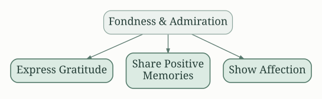
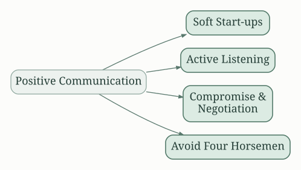
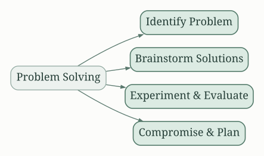
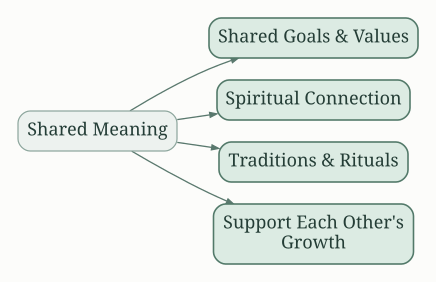
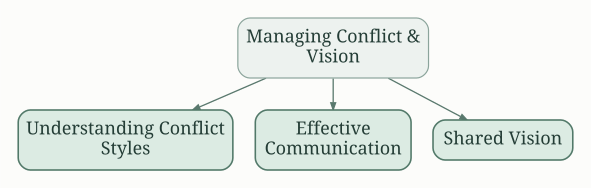

## Understanding Your Marriage's Sound Relationship House

Gottman and Silver's "The Seven Principles for Making Marriage Work Workbook" isn't just a book; it's a roadmap for building a strong, lasting relationship.  The core of their approach is the "Sound Relationship House," a metaphor illustrating the essential building blocks of a successful marriage.  The workbook guides couples through each level, providing practical exercises to strengthen their foundation.  Ignoring any one level weakens the entire structure, emphasizing the interconnectedness of these principles.

## Build Love Maps: Knowing Your Partner

This foundational principle emphasizes the importance of knowing your partner deeply.  It’s not just about knowing their job and hobbies, but understanding their hopes, fears, dreams, and daily life experiences.  The workbook prompts couples to regularly update their "love maps," actively engaging in conversations to stay connected and understand each other's evolving inner worlds.  This includes:

*   **Sharing daily details:**  Discussing the small happenings of the day helps create intimacy and strengthens the bond.
*   **Active listening:** Truly hearing and understanding your partner's perspective, without interrupting or judging.
*   **Regular check-ins:** Scheduling dedicated time for meaningful conversations, even amidst busy schedules.

## Share Fondness and Admiration: Nurturing Positive Connection

Couples who regularly express appreciation and affection for each other build a strong emotional foundation.  This isn't about grand gestures; it's about the small, everyday acts of kindness, appreciation, and affection.  The workbook encourages couples to:

*   **Express gratitude:** Verbally acknowledge and appreciate your partner's actions and contributions.
*   **Share positive memories:** Reminiscing about happy times strengthens the bond and reminds you of your shared history.
*   **Show affection:** Physical touch, compliments, and words of affirmation are essential for maintaining intimacy and connection.

## Turn Towards Each Other Instead of Away:  Responding to Bids for Connection

Throughout the day, partners make "bids" for connection—a request for attention, affection, or interaction.  The workbook emphasizes the importance of "turning towards" these bids, responding positively and engaging with your partner's attempts to connect.  Ignoring these bids erodes intimacy.

*   **Recognize bids:**  Become aware of the subtle ways your partner seeks connection.
*   **Respond positively:** Even small gestures of acknowledgment show that you care.
*   **Create opportunities for connection:** Actively seek out moments to engage with your partner.

## The Power of Positive Communication:  Fighting Fair

Conflict is inevitable in any relationship. However, the way couples handle disagreements impacts their relationship's health. The workbook teaches constructive conflict resolution techniques, focusing on:

*   **Soft start-ups:**  Beginning conversations with kindness and respect, avoiding accusatory language.
*   **Active listening:**  Truly understanding your partner's perspective, even if you don't agree.
*   **Compromise and negotiation:**  Finding mutually acceptable solutions.
*   **Avoid "the four horsemen":** Criticism, contempt, defensiveness, and stonewalling are relationship killers; learning to avoid them is crucial.

## Solve Your Solvable Problems:  Effective Problem-Solving

Not all problems are solvable, but many are. The workbook provides a structured approach to problem-solving, encouraging couples to:

*   **Identify the problem:** Clearly define the issue at hand.
*   **Brainstorm solutions:**  Generate multiple potential solutions together.
*   **Experiment and evaluate:**  Try different approaches and assess their effectiveness.
*   **Compromise and agree on a plan:**  Work together to find a solution that works for both partners.

## Create Shared Meaning:  Connecting on a Deeper Level

Beyond the practical aspects of daily life, couples need to create a shared sense of purpose and meaning. This involves:

*   **Shared goals and values:**  Understanding and aligning on your life goals.
*   **Spiritual connection:**  Finding common ground in your beliefs and values.
*   **Celebrating traditions and rituals:**  Creating shared experiences that strengthen your bond.
*   **Supporting each other's growth:**  Encouraging individual passions and ambitions.

## Manage Conflict and Create a Shared Vision

The workbook emphasizes the importance of managing conflict constructively and creating a shared vision for the future.  This includes:

* **Understanding conflict styles:** Identifying individual approaches to conflict and learning for a more positive interaction.
* **Developing effective communication skills:**  Practicing empathy, active listening and respectful expression of feelings.
* **Creating a shared vision:** Discussing long-term goals and aspirations, and finding common ground in planning for the future.

##  The Workbook's Practical Application

The power of Gottman and Silver's work lies not just in the theory, but in the practical exercises and tools provided in the workbook.  Through questionnaires, reflective exercises, and guided discussions, couples are actively involved in applying the principles to their own relationship.  This active participation reinforces learning and fosters a deeper understanding of their dynamics.  The workbook's structure provides a framework for consistent effort and progress, enabling couples to build a stronger, more fulfilling marriage over time.  It encourages self-reflection, understanding, and active participation from both partners, leading to long-lasting change and improvement in the relationship.  The focus on small, consistent changes rather than large-scale overhauls is a key element of its success.

By diligently working through the workbook, couples gain understanding of their relationship dynamics, learn effective communication strategies, and develop a stronger foundation for a lasting and fulfilling marriage.  The emphasis on proactive efforts, consistent communication, and mutual understanding provides a solid pathway for improving and strengthening the marital bond.

