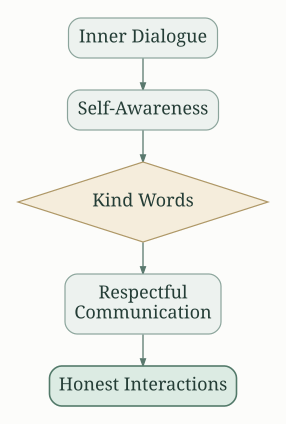
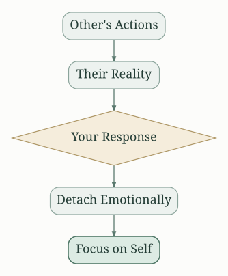
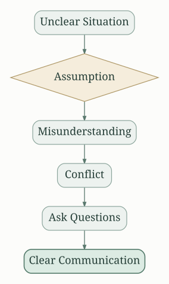
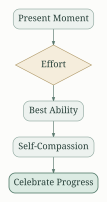

# Introduction: A Path to Personal Freedom

"The Four Agreements" by Don Miguel Ruiz presents a practical guide to personal happiness and freedom based on ancient Toltec wisdom.  It argues that self-limiting beliefs and emotional baggage are largely self-imposed and can be overcome through conscious self-awareness and a commitment to four fundamental agreements.  The book emphasizes the power of personal responsibility in shaping our reality and achieving a more fulfilling life.  Ruiz encourages a shift from reactive to proactive living, suggesting that by consciously choosing our responses, we can drastically improve our well-being and relationships.

# The First Agreement: Be Impeccable with Your Word

This is the cornerstone of the book.  Impeccable communication means speaking with integrity, saying only what you mean, and avoiding the use of language to hurt yourself or others.  

It's about aligning your thoughts, words, and actions.  Lying, gossiping, judging, and speaking negatively all violate this agreement.

**Actionable Insights:**

* **Monitor your inner dialogue:** Be mindful of your self-talk and challenge negative or self-defeating thoughts.
* **Speak with kindness and respect:**  Choose your words carefully, considering their impact on others.
* **Avoid gossip and judgment:**  Refrain from spreading negativity and focus on constructive communication.
* **Commit to honesty:**  Be truthful in your interactions, even when difficult.

# The Second Agreement: Don't Take Anything Personally

This agreement addresses the emotional burdens we carry by taking things personally.  Ruiz argues that what others do or say is a projection of their own reality, not a reflection of your worth.  Taking things personally leads to unnecessary suffering and emotional pain.

**Actionable Insights:**

* **Recognize personal projections:** Understand that others' actions are driven by their beliefs and experiences, not necessarily directed at you.
* **Detach from emotional reactions:** Develop emotional resilience by not allowing external events to dictate your feelings.
* **Practice self-compassion:** Treat yourself with kindness and understanding, even when facing criticism or negativity.
* **Focus on your own journey:**  Don't get bogged down in others' opinions or actions.

# The Third Agreement: Don't Make Assumptions

Assumptions are the root of much misunderstanding and conflict.  Ruiz stresses the importance of clear communication and avoiding the temptation to interpret situations based on incomplete information.  Instead of assuming, he suggests asking questions, seeking clarification, and expressing your needs directly.

**Actionable Insights:**

* **Communicate openly and directly:** Express your needs and feelings clearly to avoid misinterpretations.
* **Ask clarifying questions:** Don't hesitate to seek clarification when something is unclear.
* **Avoid mind-reading:** Avoid assuming another's thoughts or intentions.
* **Embrace uncertainty:**  Accept that you cannot always know the full truth, and that's okay.

# The Fourth Agreement: Always Do Your Best

This agreement emphasizes the importance of striving for excellence in all aspects of life. It's not about perfection but about consistently putting forth your best effort, given your current circumstances and capabilities.  It encourages self-compassion and acceptance. It's about understanding that your best will fluctuate depending on your emotional and physical state.  It's about giving your best in the present moment, not being trapped by self-judgment.

**Actionable Insights:**

* **Recognize your limitations:**  Understand that your best will vary from day to day.
* **Focus on your effort, not the outcome:**  Acknowledge your sincere effort, regardless of the result.
* **Practice self-compassion:** Be kind to yourself when you fall short of expectations.
* **Celebrate your progress:** Appreciate your achievements, no matter how small.

# Overcoming Domestication: The Toltec Perspective

Ruiz draws on the Toltec worldview to explain the origin of self-limiting beliefs.  He describes how societal conditioning, or "domestication," leads to the internalization of fear-based beliefs that hinder our ability to live authentically.  He suggests that by breaking free from these limiting beliefs, we can reclaim our personal power and live a more fulfilling life.  Domestication creates a system of beliefs that often contradicts our own true selves.  By being aware of this process, we can consciously choose to reject those beliefs and create our own path.

# The Power of Belief and the Dream of the Planet

The book emphasizes the powerful impact of beliefs on our lives.  Our beliefs shape our perceptions, interpretations, and actions.   Ruiz argues that we create our own reality through our beliefs and interpretations of experiences.  The "dream of the planet" refers to the shared collective consciousness and the illusionary nature of our perceived reality.  By becoming aware of this dream, we can make conscious choices that lead to greater personal freedom and well-being.

## A Journey of Self-Discovery

"The Four Agreements" is not a quick fix but a lifelong journey of self-discovery and personal growth. It requires consistent effort, self-awareness, and a commitment to living authentically. Ruiz suggests adopting these four simple agreements can transform our lives, creating more fulfilling relationships, achieving greater inner peace, and experiencing a deeper sense of purpose. The agreements offer a framework for navigating the complexities of human interaction and cultivating a more conscious and fulfilling life. They provide a pathway to personal liberation by fostering self-awareness, promoting healthy communication, and cultivating a more compassionate and understanding approach to oneself and others. Ultimately, the power to change lies within each individual's willingness to actively work towards personal transformation.

