## On Love

Gibran's musings on love transcend the romantic; it's a force shaping our lives. He cautions against possessing love, urging us to instead stand as "two lonely trees standing in the sun." True love, he emphasizes, is not about merging identities but celebrating the unique individual within the bond. It's a space where growth and independence thrive, not suffocating dependence.

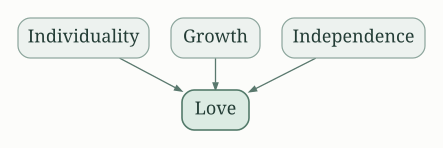

The key takeaway here is the acceptance of differences and the fostering of individual growth within the relationship.  It's a call for a mature and respectful partnership, not a possessive or codependent one.

## On Marriage

Marriage, according to Gibran, is not a mere union but a sanctuary for the blossoming of two souls. It should be a space of mutual respect, a partnership built on understanding, not control.  He discourages the seeking of solace or completion in another, emphasizing the importance of self-sufficiency.  Marriage, if entered into rightly, enhances one’s individuality, rather than diminishing it.

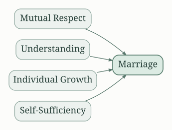

The message is clear: enter marriage as a whole, complete individual, ready to share life with another whole individual, not to "fix" each other or find completeness through another.

## On Children

Gibran's perspective on children isn't about possession or control but rather about guidance and loving detachment. He advises parents to allow their children to live their own lives, to blossom and grow according to their unique nature, not a predetermined path set by parental expectations. He advocates for providing nurturing and support without stifling their spirit and independence.  The focus should be on assisting their journey, not directing it.

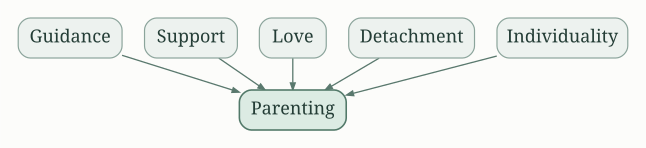

The actionable insight is to nurture independent thinking and self-reliance in children, celebrating their uniqueness instead of forcing conformity.

## On Giving

Giving, for Gibran, is not a transaction, but an act of love. It’s not about the act itself, but about the spirit behind it.  Giving freely, without expectation of return, enriches both the giver and the receiver.  True giving comes from the overflowing heart, not from a sense of obligation or duty.  He speaks against giving out of pity, emphasizing that true giving must arise from an inner generosity.

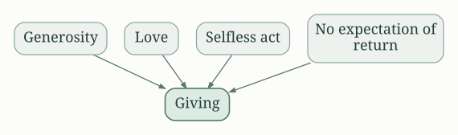

The strategy lies in recognizing the value in selfless acts and nurturing a spirit of generosity rooted in love and empathy.

## On Joy and Sorrow

Gibran presents joy and sorrow as two sides of the same coin, inextricably linked. He suggests not shunning either but embracing both as essential aspects of the human experience. Sorrow, he posits, is often a catalyst for growth and understanding, refining our sensibilities and deepening our capacity for compassion.  Resisting or suppressing either emotion hinders personal development.

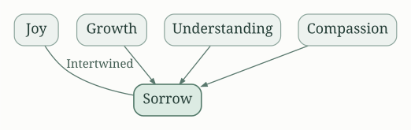

The key advice here is to accept both joy and sorrow, allowing each to contribute to a richer, fuller life.

## On Beauty

Gibran's conception of beauty transcends the superficial. He sees beauty not only in outward appearances but in the intrinsic worth of things, in their inner essence.  He encourages appreciation of nature's simple elegance and the beauty of human potential.  Beauty, he implies, is a state of being, not merely a physical characteristic.

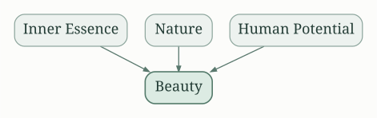

The insight is to shift the focus from external appearances to inner qualities, and to appreciate the beauty that exists in the everyday world.

## On Work

Work, for Gibran, should be more than a mere means to an end. It should be a form of self-expression, a creative outlet aligning with one's passion.  He encourages finding purpose and meaning in one's work, warning against allowing it to become solely a source of materialistic gain. He emphasizes the value of craftsmanship and dedication to one's vocation.

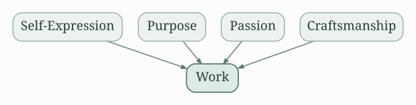

The strategy involves aligning one's work with personal values and passions, transforming it from a chore into a fulfilling aspect of life.

## On Friendship

Gibran's perspective on friendship centers on authentic connection, not superficial camaraderie. He emphasizes the importance of mutual respect, understanding, and unwavering support. True friendship transcends fleeting interests and endures through life's inevitable trials and tribulations. It’s a bond built on shared values and a understanding of each other's souls.

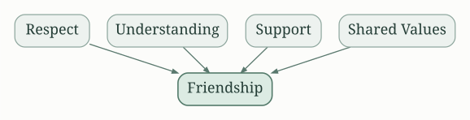

The advice is to build authentic relationships based on shared values, mutual respect, and steadfast support, rather than pursuing superficial connections.

## On Religion

Gibran’s treatment of religion advocates for a spiritual path rooted in personal experience and connection with the divine, rather than blind adherence to dogma or ritual.  He suggests that true faith is a personal journey, not a set of rules or beliefs imposed from without. He emphasizes the inner spiritual experience as more important than external religious practices.

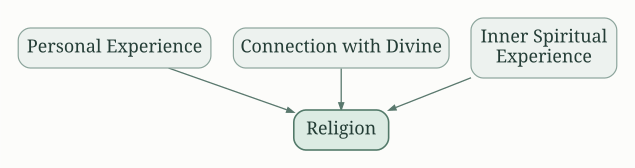

The actionable insight is to develop an individual spiritual practice rooted in inner experience and a personal connection with the divine, rather than blind adherence to religious dogma.

## On Time

Gibran presents time as a dynamic, ever-flowing current, rather than a static entity. He advises against clinging to the past or anxiously anticipating the future, urging us to fully inhabit the present moment. Every moment is a unique opportunity for experience and growth.

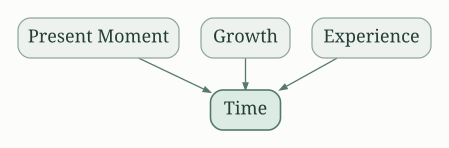

The strategy is to live fully in the present, to appreciate each moment for its unique worth, without dwelling on past regrets or future anxieties.

## On Speaking

Gibran emphasizes the importance of truthful and mindful communication.  He warns against using words to manipulate or deceive and encourages the honest expression of one's thoughts and feelings. The spoken word, he suggests, should reflect the integrity of the speaker.

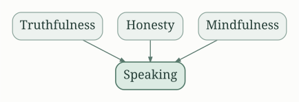

The insight is to use words carefully, thoughtfully, and truthfully, reflecting integrity and respect in all communication.

In essence, "The Prophet" offers a philosophy of life, guiding readers toward a more meaningful and fulfilling existence.  It’s a journey of self-discovery, emphasizing personal responsibility, authenticity, and a deep appreciation for the interconnectedness of all things. The book’s enduring appeal lies in its timeless wisdom, providing actionable advice applicable to the complexities of human life, regardless of time or circumstance.

