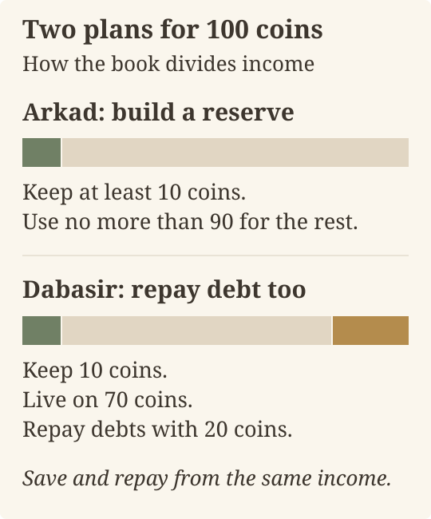

# The Richest Man in Babylon: A Summary and Key Lessons

George S. Clason's *The Richest Man in Babylon* teaches money management through fictional parables set in ancient Babylon. Its central idea is simple: income alone does not create wealth. People must keep part of what they earn, put it to productive use, and protect it from loss.

Arkad, the wealthy teacher at the center of the book, presents two linked frameworks. The **Seven Cures for a Lean Purse** explain how to build a financial foundation. The **Five Laws of Gold** explain how to handle the money that foundation produces. Other stories test these ideas through failed investments, family requests, debt, and work.

These are teaching stories written by Clason, not recovered records of ancient financial advice. Their strength lies in memorable examples. Their limits matter too: the stories make personal discipline central, but they do not offer a complete account of poverty or a guarantee of wealth.

## The opening problem: hard work without savings

Bansir, a chariot builder, and Kobbi, a musician, work for a living but have little money to show for it. They decide to ask their wealthy friend Arkad what he has learned.

Arkad explains that he began as a scribe. Algamish, a moneylender, taught him to keep part of his earnings. Paying everyone else first left him with nothing that belonged to his future self.

Saving was only his first lesson. Arkad lost his early savings when he trusted a brickmaker to buy jewels. The brickmaker knew his own trade, but he did not know gemstones. Arkad later learned to seek advice from people with experience in the actual decision he faced. Wealth or confidence in one field does not prove skill in another.

This story gives the book its basic sequence: keep money, learn how to use it, and learn from mistakes without abandoning the saving habit.

## The Seven Cures for a Lean Purse

### 1. Keep at least a tenth of what you earn

Arkad tells his students to retain at least one coin out of every ten they receive. This is the principle often called paying yourself first. Saving comes before the decision about how much is available to spend.

For example, on an income of 100 coins, his rule leaves at least 10 for future wealth and no more than 90 for other uses. Saving creates a reserve. It does not, by itself, make that reserve earn a return.

### 2. Control spending

Arkad observes that desires can grow with income. A larger wage does little for wealth if every increase becomes a new expense. He asks his students to make a budget and choose which desires fit within it.

The aim is deliberate spending, not the removal of all pleasure. A budget gives limited money a clear purpose. It also reveals when a purchase would consume the money meant for the future.

### 3. Make saved money earn more money

The third cure turns saving into productive capital. Arkad describes lending money to a shield maker whose business can support repayment with interest. The earnings can then earn more in turn.

That is compounding: returns remain invested and become part of the amount earning future returns. As a simple illustration, 100 coins earning a fixed 5% each year become 105 after one year and 110.25 after two. The second year's interest includes interest on the first year's gain. These figures illustrate the idea; they are not a return promised by the book or a forecast.

### 4. Protect the original money from loss

Arkad warns against chasing a large return before checking whether the original investment can be recovered. He stresses the borrower's ability to repay and the value of informed advice.

The brickmaker's failed jewel purchase makes this warning concrete. Familiarity with a person does not make an unfamiliar investment sound. The book's emphasis here is careful judgment and relevant expertise. It does not provide a detailed modern system for dividing investments among asset classes.

### 5. Make your home a useful investment

Clason explicitly recommends owning a home through Arkad's fifth cure. Arkad connects ownership with family wellbeing, a garden, and the eventual removal of rent payments. He also discusses borrowing to build a home.

This is stronger than a passing suggestion. It is still the argument of a parable, not evidence that every home purchase is safe or that prices always rise. A modern reader must separately consider the cost of borrowing, upkeep, and the local housing market.

### 6. Provide for future income

Arkad asks people to prepare for old age and for the support of dependents after their death. Present earnings will not necessarily continue throughout life.

This cure broadens the purpose of wealth. Money should support future needs as well as present comfort. The text discusses ways to provide that support, rather than naming a modern retirement account or insurance product.

### 7. Improve your ability to earn

The final cure concerns skill, effort, and a clear purpose. Arkad urges people to become more capable in their work and to keep learning.

This balances the focus on cutting expenses. Spending less has limits. Becoming better at a trade can improve earning power. Clason links that effort with paying obligations and treating oneself with respect.

## The Five Laws of Gold

The Five Laws revisit the same principles from the perspective of someone who already has money to manage. In the story, Arkad's son Nomasir receives gold and a tablet of guidance. He loses the money through poor decisions before learning the value of the guidance.

In plain language, the laws say:

1. **Build a reserve:** keep at least a tenth of earnings for the future and the family.
2. **Give money productive work:** find sound uses that can generate further income.
3. **Use informed judgment:** seek advice from people who understand the investment.
4. **Avoid what you do not understand:** unfamiliar ventures can consume savings.
5. **Reject impossible promises:** schemes, unrealistic returns, and one's own wishful thinking can destroy capital.

The Seven Cures cover the wider pattern of earning, spending, housing, and future security. The Five Laws concentrate on keeping and using capital. Their overlap reinforces the book's message: having money and knowing how to manage it are different achievements.

## Dabasir: saving while repaying debt

Dabasir, a camel trader, gives the book a more specific debt story. After returning from slavery in Syria, he resolves to repay what he owes. In *The Clay Tablets from Babylon*, he records a three-part plan advised by Mathon, the moneylender:

- Keep 10% of earnings for himself.
- Use 70% for living costs, including his household's needs.
- Divide 20% among his creditors in proportion to the amounts owed.

*The same 100-coin income illustrates both plans. Dabasir divides the spending portion to make room for repayment.*

Dabasir lists his debts and speaks to the people he owes. His plan combines regular repayment with the habit of keeping money for the future. He does not wait until all debt has disappeared before starting that habit.

These percentages describe the story's plan. They are not a universal budget for every reader. The useful distinction is between three jobs for income: supporting life now, meeting past obligations, and building future resources.

## Other stories: lending, opportunity, and work

In *The Gold Lender of Babylon*, Rodan, a spear maker, receives a reward and faces pressure to lend it to his sister's husband. He consults Mathon. The story separates a wish to help from the question of whether a borrower can repay. A family bond does not remove the need for judgment.

*Meet the Goddess of Good Luck* examines missed opportunities and delay. Its lesson is to act on a sound opportunity, not to treat gambling as a dependable path to wealth. This complements the warnings against reckless investment: care should support action rather than become endless postponement.

*The Luckiest Man in Babylon* treats work as a source of opportunity and dignity. Together, these stories connect money habits with conduct. Clason repeatedly favors patient learning, useful work, and kept commitments over sudden riches.

## What readers can take from the book

The book's most useful contribution is a set of questions: What part of income remains yours? What consumes the rest? How could saved money earn income? What could cause its loss? Who understands the risks better than you do?

A modern interpretation might include a regular savings transfer, a written budget, and a review of debts and investment risks. Those are applications of the principles, not new instructions hidden in the ancient setting. Clason supplies a starting framework for financial habits. He does not show that discipline alone can overcome every limit on income or every unexpected expense.

## Sources

- [Penguin Random House: George S. Clason and the pamphlet origins of the book](https://www.penguinrandomhouse.com/authors/233902/george-s-clason/).
- [Macmillan: publisher introduction and excerpt](https://us.macmillan.com/books/9781250820792/therichestmaninbabylonthecompleteoriginaleditionplusbonusmaterial/).
- [Clason's text at New Thought Library: contents and linked parables](https://newthoughtlibrary.com/clason-george/richest-man-in-babylon/pages/home.htm). The explanations above follow the Seven Cures, Five Laws, and named stories in this text.
- [Dabasir's saving plan](https://newthoughtlibrary.com/clason-george/richest-man-in-babylon/pages/richest-man-in-babylon-102.htm) and [his creditor repayment rule](https://newthoughtlibrary.com/clason-george/richest-man-in-babylon/pages/richest-man-in-babylon-104.htm).
