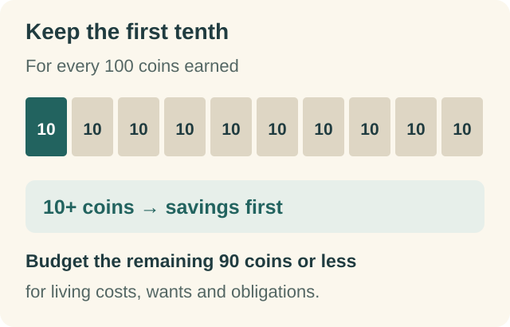
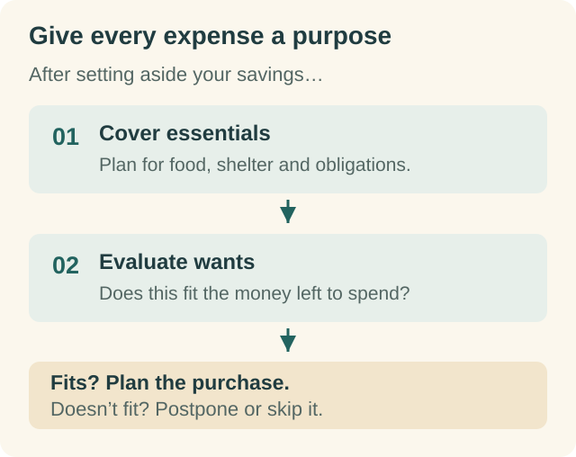
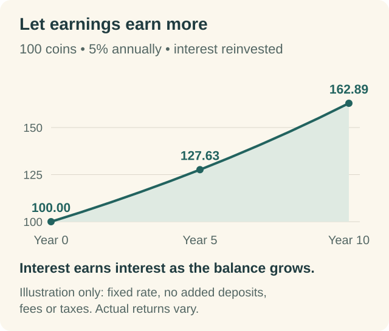
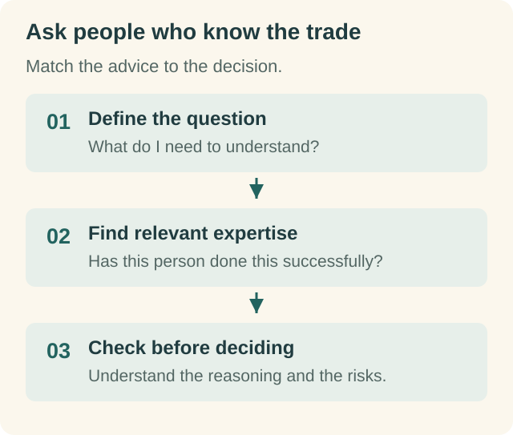
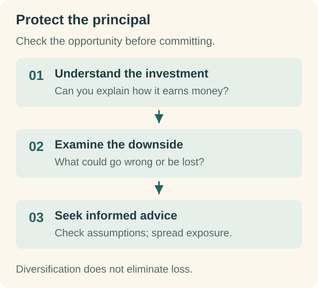
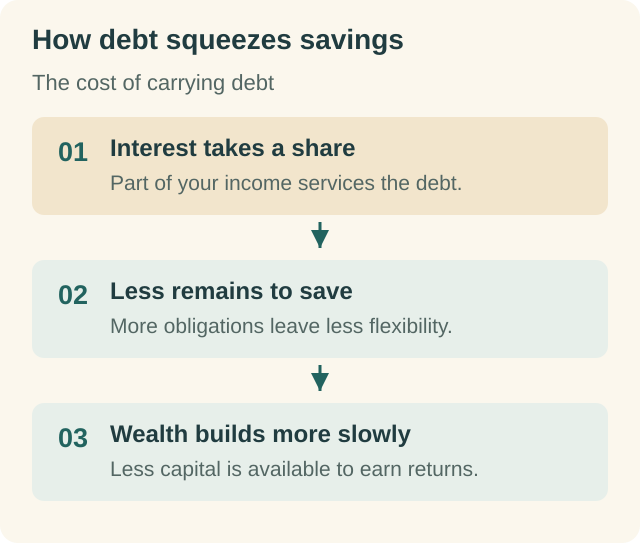

# The Richest Man in Babylon: A Summary and Actionable Insights

"The Richest Man in Babylon," by George S. Clason, isn't a traditional self-help book; it's a collection of parables set in ancient Babylon, offering timeless financial wisdom.  The stories focus on Arkad, the richest man in Babylon, and his teachings on wealth creation and management.  The core message emphasizes the importance of proactive financial planning and responsible money management, principles that remain highly relevant today.

##  The First Principle: Start to Pay Yourself First

This fundamental principle emphasizes saving a portion of your earnings *before* paying other expenses.  Arkad advises saving at least 10% of your income.  This seemingly small percentage, consistently saved, compounds over time, creating significant wealth.  Delaying gratification and prioritizing savings lays the foundation for financial security.

It's not just about saving; it's about *paying yourself first*.  This means automatically transferring a predetermined percentage of your income into a savings or investment account before covering other expenses. This ensures your savings are prioritized, preventing you from rationalizing spending it.

##  The Importance of Controlled Spending

While saving is crucial, mindless spending negates those efforts. Clason emphasizes the need for disciplined spending, advising against unnecessary expenses and impulsive purchases.  Understanding the difference between needs and wants is key to maintaining financial stability.

This conscious approach requires regular budgeting and tracking of expenses to identify areas for improvement. Cutting down on unnecessary spending frees up more resources to channel into savings and investments.

##  The Power of Compound Interest

The magic of compounding is central to Arkad's teachings.  The book highlights how small, consistent savings, earning interest, grow exponentially over time.  The longer the money is invested, the more significant the compounding effect becomes.  This principle emphasizes the importance of long-term investing strategies.

Understanding and utilizing compound interest transforms savings into a powerful wealth-building engine.  It's the "eighth wonder of the world," as Einstein famously called it.

##  Seeking Expert Advice: The Importance of Mentorship

The stories in the book highlight the value of seeking advice from experienced and knowledgeable individuals. Arkad stresses learning from those who have already achieved financial success. This proactive approach helps avoid common financial pitfalls and accelerates the learning curve.

Mentorship provides guidance, shaping smarter financial choices and accelerating wealth accumulation. It's about leveraging the experience of others to avoid costly mistakes.

## The Safe Investment of your Funds:  Protecting Your Assets

Arkad doesn't just advocate for saving; he stresses the importance of investing wisely.  He discourages risky ventures and encourages diversification, suggesting multiple streams of income and spreading investments across different assets to minimize risk.

The core principle is protecting one's capital while seeking reasonable returns.  It involves understanding investment options, conducting due diligence, and managing risk effectively.  Impulsive investment decisions are strongly discouraged.

##  The Importance of Owning a Home

The book subtly advocates for homeownership, portraying it as a safe and appreciating asset.  While not explicitly stated as a mandatory requirement, it suggests that owning a home provides a sense of security and financial stability.  It also serves as a tangible representation of one's financial progress.

##  Avoiding Debt and Seeking Financial Security

Arkad stresses the dangers of uncontrolled debt, particularly unnecessary debt.  He highlights the importance of prioritizing debt repayment and building a solid financial foundation before incurring new liabilities.  This emphasizes responsible financial management.

High-interest debts can quickly consume your earnings, impeding your financial progress.  Controlling debt is fundamental to attaining financial security and building wealth.

##  Setting Financial Goals: A Clear Vision

The book subtly promotes setting clear financial goals.  Whether it's building a house, securing a comfortable retirement, or achieving financial independence, having specific goals provides direction and motivation for consistent saving and investment.

## The Value of Continuous Learning

Financial literacy is crucial.  Arkad’s teachings encourage continuous learning and adaptation to changes in the economic landscape.  Staying informed about financial matters helps individuals make informed decisions and adjust their strategies accordingly.

## Actionable Insights: Putting it into Practice

The wisdom imparted in "The Richest Man in Babylon" isn't just theoretical; it's profoundly practical.  The key actionable points include:

*   **Develop a savings plan:**  Commit to saving at least 10% of your income consistently. Automate this process if possible.
*   **Create a budget:** Track your income and expenses to identify areas for improvement in spending habits.
*   **Eliminate unnecessary expenses:**  Consciously choose between needs and wants.  Avoid impulsive buying.
*   **Invest wisely:** Seek professional advice, diversify your investments, and prioritize risk management.
*   **Seek financial education:** Stay informed about financial matters. Read books, attend workshops, and consult experts.
*   **Set clear financial goals:** Define your short-term and long-term financial objectives to provide direction.
*   **Avoid unnecessary debt:** Control borrowing and prioritize debt repayment.

"The Richest Man in Babylon" is more than just a financial guide; it's a timeless lesson in self-discipline, financial responsibility, and the importance of long-term planning. By implementing the simple yet powerful principles outlined in the book, readers can improve their financial well-being and build lasting wealth. The key is consistent application and a commitment to making wise financial choices.

