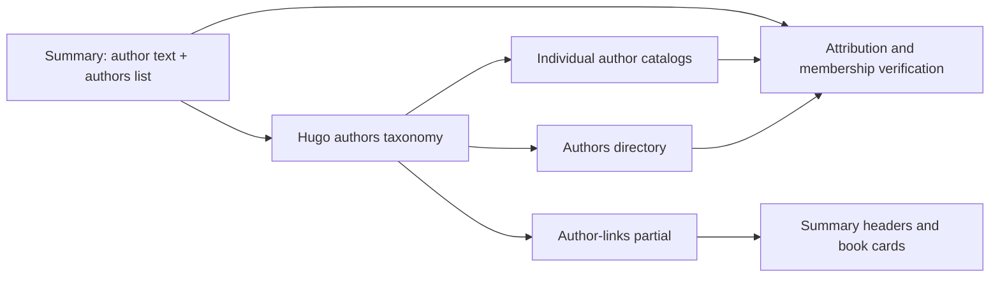

# Author pages — Plan

## Technical Design

<!-- Format: Include a concise solution description and change-relevant architecture or sequence diagram when useful. -->

Add Hugo's author = "authors" taxonomy alongside the existing category taxonomy. Retain author as the original scalar display field and add authors as an ordered, nonempty list of canonical individual display names to every summary. Use .GetTerms "authors" and each term's RelPermalink for links; do not hand-construct slugs. Reuse the catalog and shared book-card pipeline for author term pages and make the taxonomy directory heading contextual. A shared author-links partial keeps headers and cards consistent.

## Components and Interfaces

<!-- Format: Use bullets. State each component responsibility and its inputs/outputs or interface contract. -->

- Content contract: author remains the current scalar string; authors is an ordered YAML list of unique, nonblank individual names. Normalize canonical spelling deliberately while preserving display attribution.
- Migration utility: a temporary or repository-local reviewed migration tool updates front matter only. Use explicit reviewed mappings for compound credits and preserve unrelated content edits. Repeat runs must not duplicate fields.
- Author-links partial: input is a Hugo page; output is semantic escaped anchors from .GetTerms "authors". Preserve original attribution wording/separators by matching reviewed individual names against the display string; render fully expanded linked names for shared-surname shorthand. No substring replacement against rendered HTML. When a reviewed canonical spelling differs, render canonical individual names. The legacy author field remains unchanged.
- Catalog and term layout: receive a taxonomy term page and paginate its summaries ByTitle; keep category presentation intact and give author pages meaningful title/description.
- Directory and navigation: context-aware terms template plus the actual custom header navigation, rather than relying solely on configuration menus.
- Verifier: use Hugo-resolved attribution and page routes for link inspection, plus independently extracted source authors lists for expected membership. Validate schemas, labels, list shape, duplicates, canonical-name variants and route collisions; retain the standard-library verification environment. Do not introduce a second approximate slugifier.
- Writing automation: request authors lists, validate them through the site verification path before marking progress or publishing, and preserve the existing scalar-author comparison.

## Data Flow

<!-- Format: Use ordered steps or a diagram to show data transformations and boundaries. -->

1. Inventory current front matter and review all apparent coauthor groups; resolve shared surnames and known solo/collaboration identities using existing content or primary attribution sources where needed.
2. Add authors lists while retaining author values, titles, bodies, and routes.
3. Hugo builds author terms from authors lists; templates obtain actual term pages and URLs through GetTerms.
4. Headers/cards render author links, the directory renders alphabetical term counts, and author catalogs render alphabetical paginated books.
5. Verification compares source attribution, generated links, directory counts, and combined catalog membership across every pagination page. Writer automation uses the same validation before publishing.

## Decisions and Constraints

<!-- Format: Use `### Confirmed Decisions`, `### Assumptions`, `### Constraints`, `### Trade-offs`, and `### Open Questions`, each followed by bullets. -->

### Confirmed Decisions
- Use individual author grouping across categories and preserve the existing display field.
- Reuse Hugo static taxonomy pages and existing listing components.
### Assumptions
- Existing scalar attribution denotes book authors, consistent with current metadata.
- Initial author URLs can use Hugo-generated default term routes; use explicit term content paths only if real collisions require them.
### Constraints
- Hugo 0.164.0 and Python 3.11+ remain supported; no new runtime browser script or backend.
- Site verification remains standard-library Python. If extracting YAML, support the documented one-line JSON-array authors syntax explicitly and fail unsupported forms with clear errors; do not parse arbitrary YAML with a loose comma split.
- docs/ is tracked generated output. Build there only during implementation verification; do not invoke publishing scripts or push as part of the build task.
- Preserve work made concurrently, including the existing modification to content/posts/language_and_linguistics/the-unfolding-of-language/index.md observed during specification.
### Trade-offs
- Adding a field to all summaries is a larger migration but supports correct multi-author grouping without breaking scalar-author consumers.
- Review-driven migration avoids unreliable automatic splitting of compound names.
### Open Questions
- None blocking specification. Resolve any ambiguous names or real slug collisions during the inventory step before migrating those records.

## File Changes

<!-- Format: Use bullets. Name each affected file or boundary and the intended change. -->

- hugo.toml: register authors taxonomy while keeping categories; keep configuration navigation consistent with the actual header if touched.
- content/posts/**/index.md: add reviewed authors lists only.
- layouts/_partials/author-links.html (new): shared author link rendering.
- layouts/_default/single.html and layouts/_partials/book-card.html: use the shared partial for author metadata.
- layouts/_default/terms.html: contextual category/author directory headings and counts.
- layouts/_default/list.html and layouts/_partials/catalog.html: adapt only where author-specific headings, descriptions, and catalog semantics require it; retain category styles and order.
- layouts/_partials/header.html: add Authors link and active state.
- assets/css/custom.css: minimal link/focus and directory adjustments if existing styles are insufficient.
- specs/author-pages/author-migration.json: reviewed one-time mapping from legacy display strings to individual credits; not a runtime registry.
- scripts/author_pages.py (new): shared strict credit parser, known alias validation, HTML inspection, and author-page verification; preflight in scripts/build_site.sh.
- scripts/verify_site.py: attribution, directory, catalog, link, collision, and membership checks.
- scripts/test_author_pages.py (new): focused data-validation and temporary Hugo fixture tests, including pagination without requiring 37 real books by one author.
- scripts/write_random_summary.sh and scripts/test_write_random_summary.py: authors prompt, validation, and updated valid/invalid fixtures.
- README.md: author data contract and browsing documentation.
- docs/**: regenerate production output through the existing build command after source verification.

## Failure Handling

<!-- Format: Use bullets or a table with trigger, implementation response, and recovery. -->

- Missing/non-list/empty authors or blank/nonstring/duplicate entries: fail verification with source file and field; never silently publish an unlinked fallback.
- Unknown shorthand, conflicting canonical names, or potential slug collisions: stop that migration item, review source credits, then choose canonical identities or explicit distinct routes; never guess from separators.
- Broken author link, incorrect count, missing coauthored membership, or unexpected catalog book: report author, summary, and route and fail the build verifier.
- Automation omits or supplies invalid authors: fail before progress update and publishing; retain the partial summary for correction as in existing failure handling.
- Build/verification fails: preserve source edits for correction; do not publish. Production output is generated and can be rebuilt after fixing source.

## Implementation Steps

<!-- Format: Use ordered, small, independently checkable steps. Include dependencies when relevant. -->

1. Inventory and review author credits, resolve compound/shared-surname names and canonical identities, and record the reviewed mapping and any collision decisions. Check: all current summaries have an explicit reviewed mapping without modifying unrelated work.
2. Add the structured authors field to existing summaries and enable the Hugo taxonomy. Check: every published summary has valid unique individual credits and term generation succeeds.
3. Implement the shared author-link partial and connect summary headers and book cards. Check: solo and coauthor links resolve, readable attribution is preserved, and no nesting or escaping errors occur.
4. Add the Authors directory/navigation and adapt author term catalogs, titles, descriptions, and minimal styles. Check: directory counts and alphabetical catalogs render with category pages unchanged.
5. Add attribution and generated-site verification plus focused author fixtures. Check: malformed data, duplicates, name/collision failures, membership, and pagination cases pass their expected outcomes.
6. Update writing automation, its fixtures, and README author examples. Check: valid solo/coauthored additions pass; missing or malformed authors fail before progress/publishing.
7. Run the focused tests, existing automation tests, and complete production build/verifier; inspect keyboard/mobile/desktop/no-JavaScript examples and review the generated diff. Check: all acceptance criteria have evidence and only intended changes remain; record deviations without publishing.

## Verification Steps

<!-- Format: Use ordered or bulleted checks. Reference spec acceptance IDs where applicable. -->

1. AC-001: Parse generated summary headers and all shared book cards to assert author anchor labels/targets correspond to their source authors list and existing term pages; inspect keyboard activation and escaped names.
2. AC-002: Independently derive expected author-to-summary sets from source front matter; compare against catalog links across all pagination pages. Explicitly assert John Gottman's solo books and his Nan Silver/Julie Schwartz Gottman collaborations share one catalog; similarly check Daniel Goleman's collaboration credits.
3. AC-003: Verify /authors/ has exactly one alphabetical entry per published author, correct unique-summary counts, and navigation links on representative page kinds; categories still display their own heading.
4. AC-004: A temporary Hugo fixture with more than 36 books attributed to one author proves page size, alphabetical order, count, navigation and complete membership across pages; include a single-book author and cross-category books.
5. AC-005: Run ./scripts/build_site.sh and inspect the diff to preserve scalar author strings, existing summary URLs and search-record contract; retain image, metadata, canonical, category and feed checks. Compare source changes to confirm bodies/titles are untouched by migration.
6. AC-006: Run python3 scripts/test_author_pages.py with valid punctuation/diacritics and shared-surname cases plus invalid blank, missing, non-list, duplicate, inconsistent-name and slug-collision fixtures. Confirm errors identify affected sources. Review the full migration mapping, especially every compound credit.
7. AC-007: Run python3 scripts/test_write_random_summary.py with updated valid solo/coauthor records and invalid authors cases; confirm no publishing/progress update on failure. Build new-summary fixtures and verify catalog inclusion under every credited author.
8. AC-008: Inspect representative summary, coauthor catalog, and directory at mobile and desktop widths with JavaScript disabled; navigate author and pagination links by keyboard and check visible focus, readable wrapping and no horizontal overflow.
9. Run msdd review "Author pages" for artifact consistency before handoff. During implementation, record actual command outcomes, visual evidence, and justified deviations; implementation evidence is recorded below.

Evidence: T1 inventory reviewed 839 summaries / 720 display strings, including all 78 compound strings. The reviewed mapping is author-migration.json. Shared-surname names were expanded using publisher/author sources: https://sophiainstitute.com/contributors/art-laraine-bennett/ ; https://gulf.alpha.org/the-pre-marriage-course/ ; https://ourpeacefulfamily.com/our-peaceful-family/ .

Evidence: First Year of Marriage has a pre-existing incorrect legacy credit, "Marcus and Ashley Willis". The authors' own book page identifies Marcus and Ashley Kusi: https://ourpeacefulfamily.com/newlyweds-guide-first-year-marriage-book-wedding-gifts/ . Its structured credits will use those verified identities; legacy title, scalar author, and body are retained. Visible links use canonical names when the original string cannot represent them. This resolves identity within the approved migration scope.

Evidence: Canonicalized five verified name variants (Alan W. Watts, Max H. Bazerman, Noah J. Goldstein, Richard J. Davidson, Robert B. Cialdini) to existing shorter names. James Collins (The Energy Plan), Jim Collins, and JL Collins remain distinct people. Sources: https://www.penguinrandomhouse.com/authors/61635/alan-watts/ ; https://www.library.hbs.edu/working-knowledge/collections/max-h-bazerman ; https://www.influenceatwork.com/books-and-publications/ ; https://www.anderson.ucla.edu/faculty-and-research/management-and-organizations/faculty/goldstein . The reviewed inventory yields 779 canonical names.

Evidence: T2 added JSON-style YAML authors arrays to all 839 summaries and enabled the authors taxonomy. Removing each inserted authors line reproduces the pre-migration working file byte for byte. Hugo 0.164.0 built successfully with --panicOnWarning to /tmp/booksummary-author-preview.

Evidence: T3 shared author-links partial renders canonical term anchors in headers/cards, preserves existing separators for matching names, and expands shorthand/corrected credits. Warning-free preview build plus full HTML parsing confirmed all author targets (including percent-encoded diacritics) and no nested anchors; inspected Kusi and Lee coauthor headers.

Evidence: T4 warning-free preview confirms Authors navigation, contextual directory headings, author-specific descriptions, and reused alphabetical catalog. John Gottman has 10 summaries and Daniel Goleman 7, including collaborations. Single-book count grammar and diacritic term routes render correctly. Existing Crimson Text/light identity is retained; DESIGN.md is absent and can be generated later with impeccable document.

Evidence: T5 added a standard-library author verifier and preflight, including independent source membership, all header/card links, actual Hugo routes, directory counts, known spelling aliases, canonical-name/route collisions, and complete pagination. Hugo uses accent-insensitive alphabetical directory collation, so the directory check normalizes combining accents for ordering. Catalog ordering uses the existing ByTitle search export.

Evidence: Six focused tests pass, including a real 39-book Hugo fixture across two categories, multiple coauthors, single-book authors, HTML escaping, initials/diacritics, shared-surname expansion, missing/malformed/duplicate fields, inconsistent names, deliberately corrupted membership/counts/links, and a simulated generated route collision. Supported authors syntax is a one-line JSON array (valid YAML); unsupported YAML forms fail clearly without adding PyYAML.

Evidence: T6 README documents required one-line authors arrays, coauthor examples, canonical spelling, author navigation, and local validation. Writer prompt requests individually verified authors and calls the shared validator immediately after writing, before build/progress/publish. Eleven isolated automation tests pass, including valid coauthors, missing/malformed/duplicate authors, and failure preservation.

Evidence: T7 / AC-005 final production build: ./scripts/build_site.sh passed on Hugo 0.164.0; verified 839 summaries, 839 search records, images, diagrams, metadata, feeds, and local links across 2,516 HTML pages. Generated 779 author catalogs plus their directory and RSS outputs under docs/. No publishing or Git push was run.

Evidence: AC-001 / AC-002 / AC-003 generated-site checks passed for every summary header, every shared card, every author directory entry/count/route, and complete exact author catalog membership. John Gottman has 10 summaries, including both Nan Silver and Julie Schwartz Gottman collaborations; Daniel Goleman has 7 including Richard Davidson and Robert Kaplan collaborations. Single-book and diacritic pages passed.

Evidence: AC-004 / AC-006 six focused author tests passed. A real Hugo fixture generated 39 books across two categories, showing 36 on page one and 3 on page two, with correct ordering/counts. Deliberate malformed attribution, duplicate credits, inconsistent canonical names, corrupted links/counts/membership, and generated route collisions were detected with actionable errors.

Evidence: AC-005 migration audit removed each added authors line and compared against all 839 pre-migration working files: all original text was preserved, including the pre-existing Unfolding of Language changes. HEAD and generated search.json retain the same summary route set, record keys, title values, and scalar author values. git diff --check passed. Concurrently created AGENTS.md and existing .claude/.codex directories were left untouched.

Evidence: AC-007 eleven isolated writer automation tests passed, including valid coauthored output and missing/malformed/duplicate authors rejection before completion/publishing. The real Hugo fixture demonstrates newly added solo/coauthored summaries appear under all credited names.

Evidence: AC-008 Playwright Chromium with java_script_enabled=False passed directory, John Gottman catalog, Anne Brontë single-book catalog, and a Gottman/Nan Silver summary at 390px and 1280px viewport widths. Checked no horizontal overflow, Tab focus with visible outline, Enter author navigation, directory-to-author and catalog-to-summary navigation. 200% text sizing passed; screenshots were inspected for mobile summary/catalog and desktop directory. Evidence screenshots and route checks are in /tmp/author-pages-*.png and /tmp/author-pages-browser-evidence.json. A separate real-browser fixture passed keyboard Next navigation to page two (3 books) and Previous to page one (36 books) with JavaScript disabled.

Evidence: Browser-check adjustment: CSS zoom on the root element collapsed its layout in headless Chromium, so that artificial check was replaced with 200% text sizing and viewport reflow checks. No production CSS change was needed for that test-harness behavior.

Evidence: msdd review "Author pages" passed with no structural or technical completeness gaps. All acceptance criteria have implementation and verification evidence. New contributor data uses the explicitly documented JSON-array subset of YAML; this keeps verification dependency-free.

Evidence: T7: Full production build, source preservation audit, focused tests and real browser checks passed; evidence recorded above.

Evidence: T8: All generated credit labels/targets and every header/card checked; real Tab/Enter author navigation passed.

Evidence: T9: Source-derived exact membership passed for all catalogs, including the 10-book Gottman and 7-book Goleman cases.

Evidence: T10: Alphabetical directory entries, counts, real routes, and Authors navigation passed; category heading preserved.

Evidence: T11: 39-book multi-category Hugo fixture and real no-JavaScript browser pagination passed, 36 + 3 books; single-book pages passed.

Evidence: T12: Full build and all existing verifier checks passed; search compatibility and byte-preserving source migration audited.

Evidence: T13: Six focused data and Hugo tests passed, including invalid attribution, aliases, route collision and corrupted generated output.

Evidence: T14: Eleven isolated writer tests passed; new solo/coauthored fixture catalogs passed complete membership verification.

Evidence: T15: 390px/1280px and enlarged-text browser checks passed with JavaScript disabled, visible keyboard focus and working links.

Evidence: T17 (reconciled from original T16 after updating the verification wording): msdd review passed, git diff --check passed, and all implementation/acceptance evidence is recorded.
